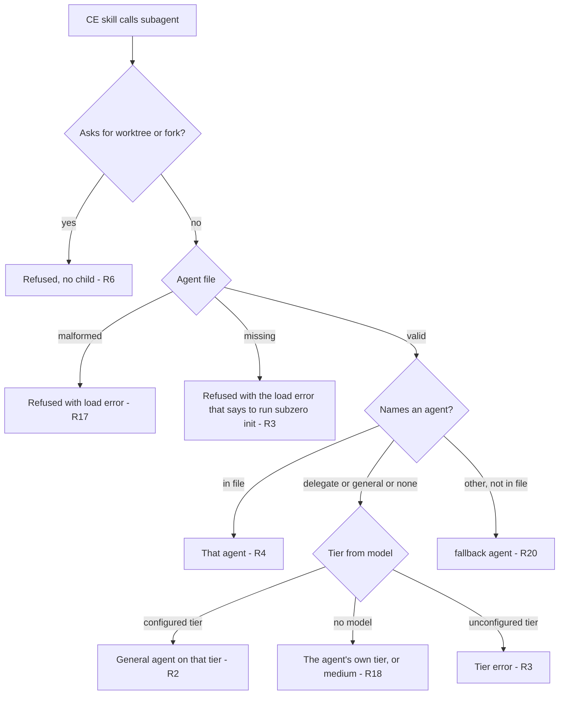
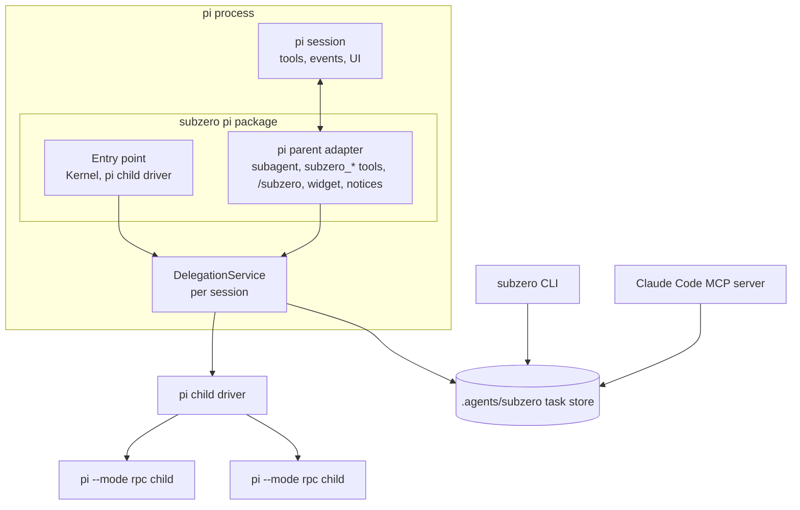
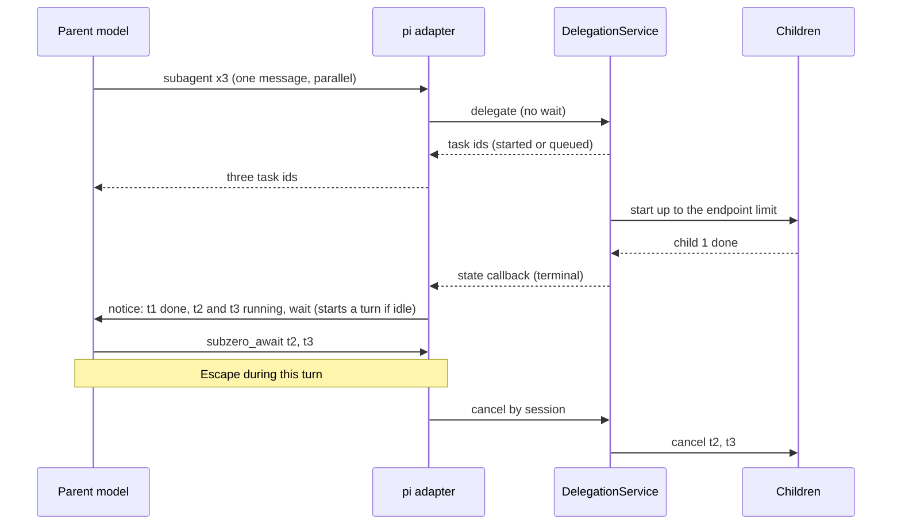
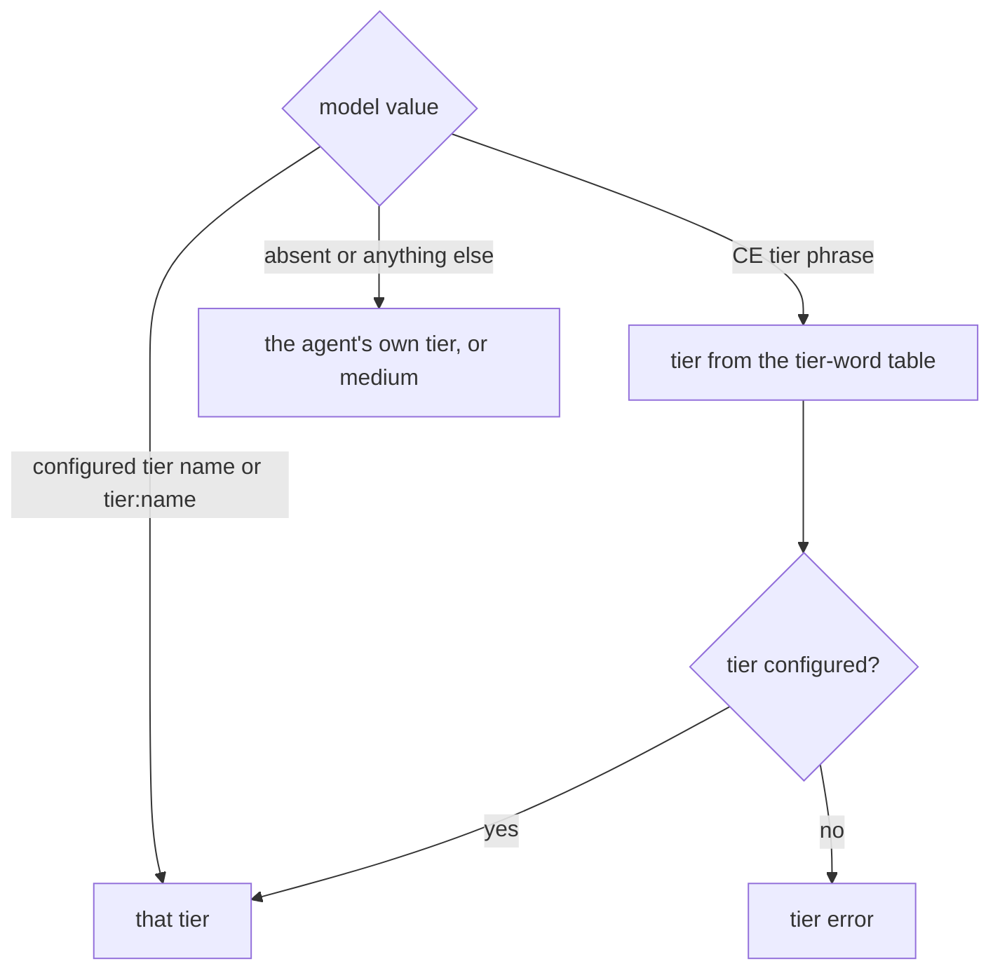
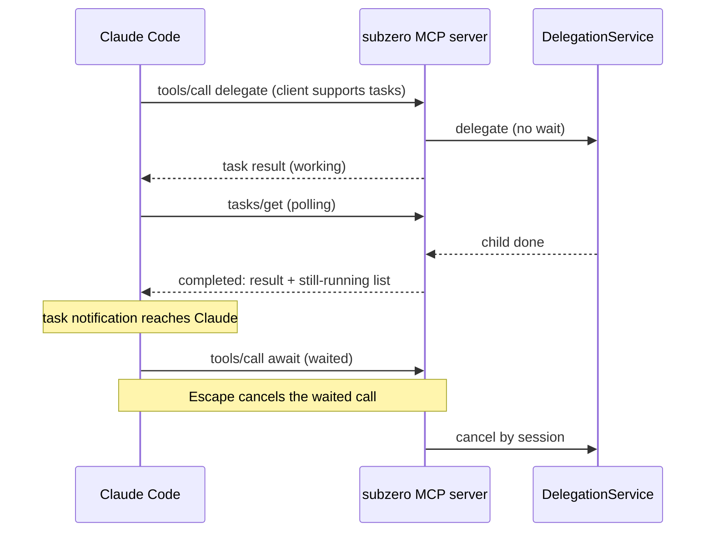
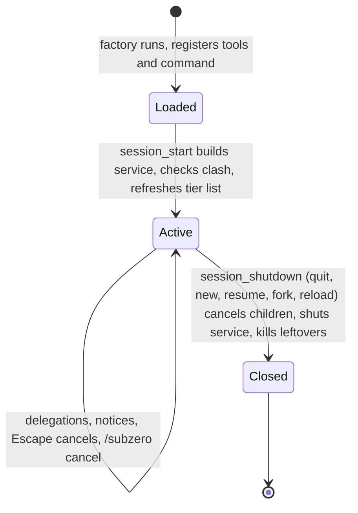
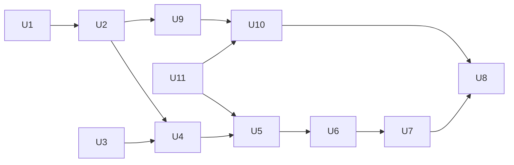

# pi Parent Extension - Plan

## Goal Capsule

- **Objective:** A developer working in pi can run compound-engineering skills and have every subagent those skills start, unless subzero refuses it (R6, R20), run as an isolated subzero child. Each child runs on the model its request maps to in the same `.agents/subzero.yaml` the developer uses from Claude Code, or on the `medium` tier when its request names none (R2, R3, R18). Its task shows up in the shared task store and the `subzero` CLI.
- **Means:** a native pi extension that takes over pi's `subagent` tool and runs a subzero core for each pi session in-process, as the second parent adapter next to the Claude Code plugin (KTD1, KTD5).
- **Product authority:** the Product Contract below. R-IDs win on behavior; KTDs win on mechanism.
- **Execution profile:** Deep, eleven units (U1 to U11). TypeScript on Node 22, esbuild bundles, vitest with the scripted fake pi, and the `design/*.sigil` contracts and `docs/design.md` updated with the code they describe. Target pi is 1.5.2; target Claude Code is 2.1.304 or later.
- **Stop conditions:** stop and ask if any of these happens:
  - pi 1.5.2 cannot start a child with the flags in `src/pi/launch.ts` and no equivalent flag set keeps the isolation of R5.
  - pi offers no way to deliver a message that starts a turn when the session is idle (R22).
  - Making `medium`, `general` and `fallback` required cannot be done without changing the Claude parent's pass-back (R8).
  - Neither MCP tasks nor the hook fallback in KTD11 can deliver a Claude background result without a user prompt (R28).
- **Who finishes:** `ce-work` implements U1 to U7, U9, U10 and U11. U8 needs a person with pi 1.5.2, Claude Code 2.1.304 or later, a local model in `models.json`, and pi-subagents removed from `~/.pi/agent/settings.json`.

---

## Revision 2026-11-12 (after the contract review)

The Sigil contracts (`design/*.sigil`) were rewritten against this plan and reviewed independently, and the user then changed several decisions. **Where this section and the text below disagree, this section wins.** The requirements, decisions and units below were updated to match; the reasoning that the removed fallback keeps in places is history.

| Was | Now | Where it shows |
|---|---|---|
| A request the file cannot place runs on the pi session's model (the session-model fallback), with a starter general agent when the file is missing. | There is no session-model fallback. A pi project with no agent file is refused with the load error that says to run `subzero init`. An unconfigured tier is a tier error. | R3, R17 to R20, R23, KTD2, KTD16, U2, U4 |
| The agent file requires a `default` tier; `general` and `fallback` are optional. | The tier named `medium` is the default tier and is required. The file must also hold `general` and `fallback`, or it does not load and the error names the missing one. `subzero init` writes all three. | R18, R20, KTD3, U9 |
| A request with no `model` runs on `large` when configured, else on the session model. | It runs the agent on its own tier, or on `medium`. | R18, AE12 |
| An unmatched `model` value runs on the session model and the reply says so. | It is ignored (treated as no value) and the reply says it was not used. On Claude Code it is still a tier error with a pass-back. | R19 |
| A stop notice says that a person stopped the task. | It says the task was stopped, not who stopped it. | R14, KTD7 |
| `routing.hook` and `routing.generic_agents` belong to the agent configuration. | They belong to the Claude hook processes. | U9 |
| The pi RPC client targets pi 0.87. | pi 1.5.2, with the child flags verified on it. | U3 |
| (new) | Names: parent host, child host, parent model. Two new contracts, `pi-extension` and `claude-plugin-commands`; `mcp-server` and `routing-hooks` are now `claude-mcp-server` and `claude-routing-hooks`. | all |
| (new) | The CE tier word `session model` still maps to `large`; it is not a fallback. | KTD3 |

Removed from the contracts: the session-fallback field of the Delegation, the fallback child host, the session agent definition, the starter general agent, its 1800 s timeout and the default limit of 4.

---

## Product Contract

Product Contract preservation: changed R4, R8, R10, R13, R14, AE4, AE7, F1 and F2, and added R17 to R31 and AE9 to AE20. On 2026-11-12 the user also revised R3, R8, R17 to R20 and R23 and AE2 to AE4 and AE12 (see the Revision section). The reasons:
- Research found the existing `fallback` agent rule (R4, AE4).
- The user chose background by default with completion notices, an idle stop through `/subzero cancel`, and cancel on session switch (R10, R13, R14, AE7, F1, F2).
- The user asked for the Claude Code parent to behave the same where Claude Code allows, which narrows R8 and adds R26 to R31.

### Summary

subzero ships a pi package that replaces pi-subagents as the subagent primitive for compound-engineering in pi. A subagent request on a tier configured in `.agents/subzero.yaml` runs on that tier's model. A request that names no tier runs on `medium`, and a pi project with no agent file is refused with an error that says to run `subzero init`. Requests run in the background by default, and each finished child wakes the parent model with a notice. The pi user can watch running children, list, attach to and cancel tasks, and stop every child with Escape during a turn. The Claude Code parent gains the same request mapping, background tasks with result notices, cancel-all on Escape, a cancel command, and cancel on `/clear`.

### Problem Frame

subzero today has one parent: Claude Code. The same developer also works in pi, with compound-engineering installed as a pi package and pi-subagents supplying the `subagent` tool that CE's skills call in pi. The tiers they set up for Claude Code mean nothing there. A CE subagent in pi runs wherever pi-subagents sends it, outside subzero's task store and CLI. The local model they configured as `small` goes unused from pi. Having a parent in pi is a stated product goal (G3 in `docs/problem.md`), and the design already places the pi adapter as a native extension that imports the core (`docs/design.md` §5.3, decisions D2 and D3), but nothing is built.

### Actors

- A1. pi user: the developer running a pi session in a project. Owns `.agents/subzero.yaml`.
- A2. Parent model: the pi session's model, running a CE skill that asks for subagents.
- A3. subzero extension: loaded into the pi session; it is that session's subzero core.
- A4. Child: an isolated pi process that subzero starts for one task.

### Key Decisions

- **Replace pi-subagents for compound-engineering.** One primitive handles every CE subagent. Governs R1, R7. (session-settled: user-directed — chosen over routing alongside pi-subagents, where unconfigured tiers and named agents would stay on pi-subagents: one primitive for every CE subagent, accepting the loss of pi-subagents' Claude and Codex children and chains.)
- **No session-model fallback; `medium` is the default tier.** Governs R3, R18, R19, R23. (session-settled: user-directed — the session-model fallback was removed as too complicated; `medium` is the default tier, `subzero init` writes it, and the file must hold `general` and `fallback`.)
- **A pi project with no agent file is refused until `subzero init` writes one.** Governs R3. (session-settled: user-directed — chosen over a built-in `medium` default: nothing runs on a model that the agent file does not name.)
- **A broken agent file is never masked.** Governs R17. (session-settled: user-approved — proposed over falling back on any load error and confirmed: a typo must not silently move every child off the configured tiers.)
- **subzero owns the `subagent` name.** CE's own wording reaches subzero with no change to CE. Governs R1, R7. (session-settled: user-directed — chosen over a separate tool name that coexists with pi-subagents, and over a separate name plus redirecting `subagent` calls: no CE change, with a clear clash warning.)
- **Unknown agent names follow the existing `fallback` rule.** `delegate`, pi-subagents' generic agent, means the general agent. Governs R4, R20. (session-settled: user-approved — proposed over always refusing an unknown name and confirmed: the same rule as the Claude parent, and models used to pi-subagents keep working.)
- **Background by default, with a completion notice.** Governs R10, R21. (session-settled: user-directed — chosen over foreground by default with or without a notice: matches pi-subagents, which pi models are used to.)
- **Each finished child wakes the model and says what is still running.** Governs R21, R22. (session-settled: user-directed — chosen over one wake per batch and over never waking: the model reacts to each result but is told to wait for the rest.)
- **Foreground in print and json modes.** Governs R24. (session-settled: user-approved — proposed over refusing background requests there and confirmed: a background child would be killed when pi exits.)
- **Worktree-isolated requests are refused.** Governs R6. (session-settled: user-directed — chosen over running in the shared checkout and over building worktree mode now: safety without a larger scope.)
- **Escape stops every child of the session during a turn; `/subzero cancel` stops them when pi is idle.** Governs R13, R14. (session-settled: user-directed — Escape-cancels-all chosen over cancelling only the interrupted turn's children or only awaited children; for the idle case `/subzero cancel` chosen over Escape-only and over a dedicated shortcut, because pi gives an extension no Escape event while idle.)
- **A session switch or reload cancels every running child of the old session.** Governs R25. (session-settled: user-directed — chosen over letting them run on into the store and over keeping them across a reload only: simple, and no orphans.)
- **Install as a pi package from a git branch.** Governs R15. (session-settled: user-directed — chosen over an npm package and over a local path only: no npm publish needed, real installs from day one.)
- **The Claude Code parent behaves the same where Claude Code allows.** It gets the same request mapping, background by default with result notices, Escape cancelling everything, a cancel command, and cancel on `/clear`. Unconfigured tiers keep passing back to Claude's own Agent tool, which is Claude's session model. Governs R8, R26, R27, R28, R29, R30, R31. (session-settled: user-directed — chosen over keeping the Claude parent unchanged and over parity on request mapping only: one behavior across parents.)
- **Claude background runs as MCP tasks, not Channels.** Claude Code 2.1.304+ shows an MCP task in `/tasks` and delivers its result as a task notification. Channels are a research preview that needs a development flag for this plugin and do not work under `-p`. Governs R27, R28. (session-settled: user-approved — proposed over Channels and confirmed, with a hook-based wake as the fallback.)

### Requirements

**Subagent primitive**

- R1. The extension provides pi's `subagent` tool, so a CE skill in pi reaches subzero with no change to CE.
- R2. A request whose tier is configured in `.agents/subzero.yaml` runs as a child on that tier's host, model and thinking level.
- R3. A request whose tier is not configured is a tier error that names the tier and lists the configured tiers, and a project with no agent file is refused with the load error that says to run `subzero init`. No request runs on a model that the agent file does not name.
- R4. A request that names an agent in the agent file runs that agent, and the names `delegate` and `general` run the general agent.
- R20. A name the agent file does not hold runs the file's `fallback` agent with a notice. The file must hold a `fallback` agent, or it does not load.
- R18. A request with no `model` runs the agent on its own tier, or on the `medium` tier.
- R19. A `model` value that is neither a configured tier name nor a CE tier phrase is ignored and treated as no value, and the result says the value was not used.
- R17. A malformed agent file refuses the request with its load error; nothing hides it.
- R5. Every child is isolated the way today's pi children are: only the declared skills, with no extensions, context files or prompt templates.
- R6. A request that asks for worktree isolation or a fork is refused with an error saying subzero does not support isolation yet, and no child starts.
- R7. When another extension also provides `subagent`, the pi user sees a warning at session start that names the clash and which extension owns `subagent`, and says to remove pi-subagents.
- R8. The Claude Code parent keeps passing a request for an unconfigured tier, an unmatched `model` value, or one made with no agent file, back to Claude's own Agent tool.



**Running children and the task model**

- R9. Several requests in one parent turn run at the same time, up to each endpoint's parallel limit. The parent gets each child's whole final message, never its transcript.
- R10. A request runs in the background by default and returns its task id at once; `async: false` makes it wait and return the child's whole final message. The parent model has await, tasks and cancel tools that mean what they mean on the Claude parent.
- R21. When a background child finishes, subzero posts a notice into the session that names the task and its status, lists the session's children still running, and tells the model to wait for them before continuing.
- R22. A notice that arrives while pi is idle starts a turn; one that arrives during a turn joins that turn.
- R23. Children run at most as many at a time per endpoint as the agent file's endpoint limit says; an endpoint with no entry has no limit.
- R24. In pi's print and json modes, every request runs in the foreground, whatever `async` says.
- R11. Tasks started from pi go to the same project task store as the Claude parent's, so the `subzero` CLI lists and shows them.

**pi user surface**

- R12. While children run, pi's UI shows each running or queued child with its tier, model and elapsed time.
- R13. Escape during a parent turn cancels every running or queued child this session started, including background children from earlier turns. Each ends with the status `cancelled`.
- R14. A `/subzero` command lists this session's tasks and prints the command that attaches to one; `/subzero cancel` cancels every running child of the session, and `/subzero cancel <id>` cancels one.
- R25. Starting a new session, resuming or forking one, or reloading extensions cancels every running child of the old session, and the user sees how many were cancelled.

**Claude Code parent**

- R26. Claude's `delegate` accepts the same tier names and CE tier phrases as pi's `subagent`, and the same `delegate` and `general` agent aliases, under the rules of R4 and R20; a malformed agent file is refused with its load error.
- R27. When Claude Code supports MCP tasks, `delegate` runs in the background by default as a Claude Code background task that the user can see and stop in `/tasks`; otherwise it waits by default, as today.
- R28. When a background delegation finishes, Claude receives its result as a notification that also lists the session's children still running and tells Claude to wait for them.
- R29. Escape during a `delegate` or `await` call that Claude is waiting on cancels every running or queued child of the Claude session; stopping one background task from `/tasks` cancels only that task.
- R30. A `/subzero:cancel` command cancels every running child of the Claude session, or the one whose id it is given.
- R31. `/clear` and an in-session `/resume` cancel every running child of the session they leave.

**Distribution**

- R15. The extension installs with `pi install git:github.com/qoherent/sub0@<branch>` from a release branch built from this repo's source, released alongside the Claude plugin branch.
- R16. The README covers the pi install, the clash with pi-subagents, background-by-default with notices, the `medium` default and what `subzero init` writes, and the limits in R6 and Scope Boundaries.

### Key Flows

- F1. CE fan-out on configured tiers
  - **Trigger:** A2 runs a CE skill that asks for several "cheapest capable" subagents in one message.
  - **Actors:** A2, A3, A4
  - **Steps:** A2 calls `subagent` once per brief; A3 resolves each to the configured tier and returns task ids at once; children start up to the endpoint limit and A1 sees them in pi's UI; each finished child posts a notice listing the others still running; A2 awaits the rest and collects every whole final message; every task is in the store.
  - **Covered by:** R1, R2, R9, R10, R11, R12, R21, R22
- F2. Stop everything during a turn
  - **Trigger:** A1 presses Escape while A2's turn runs, with children from this turn and from earlier background dispatches running.
  - **Actors:** A1, A3, A4
  - **Steps:** The parent turn stops; A3 cancels every running or queued child of the session; each task ends `cancelled` in the store.
  - **Covered by:** R13
- F3. Background child finishes while pi is idle
  - **Trigger:** A child started in an earlier turn finishes after A2's turn has ended.
  - **Actors:** A3, A2
  - **Steps:** A3 posts the notice with the still-running list; the notice starts a turn; A2 collects that result or waits for the rest, as the notice tells it.
  - **Covered by:** R21, R22

### Acceptance Examples

- AE1. **Covers R2.** Given `.agents/subzero.yaml` maps `small` to a local Qwen model, when a CE skill in pi asks for a "cheapest capable" subagent, the child runs on that Qwen model.
- AE2. **Covers R3.** Given a project with no `.agents/subzero.yaml`, when a CE skill asks for any subagent, the call fails with the load error that says to run `subzero init`, and no child starts.
- AE3. **Covers R3, R19.** Given an agent file whose tiers are `medium` and `small`, when a CE skill asks for a "session model" subagent, the call returns the tier error that names `large` and lists `medium` and `small`.
- AE4. **Covers R20.** Given an agent file with no `fallback` entry, when a request is made, the load fails with an error that names the `fallback` agent and says to run `subzero init`, and no task is created.
- AE9. **Covers R20.** Given an agent file with a read-only `fallback` agent, when `subagent` names `scout`, the `fallback` agent runs and the result carries the notice.
- AE5. **Covers R6.** When a CE skill asks for a worktree-isolated subagent, the call fails with the isolation error and no child starts.
- AE6. **Covers R7.** Given pi-subagents is also installed, when a pi session starts, the user sees the clash warning naming which extension owns `subagent`.
- AE7. **Covers R13.** Given two background children from an earlier turn and one from the current turn, when the user presses Escape during the current turn, all three end `cancelled` and `subzero tasks` shows them so.
- AE10. **Covers R14.** Given pi is idle with two background children running, when the user types `/subzero cancel`, both end `cancelled` and the command reports 2 cancelled.
- AE8. **Covers R8.** Given a project with no agent file, when Claude Code calls `delegate`, it gets the missing-agent-file error with the pass-back instruction, and Claude runs the subagent on its own Agent tool.
- AE16. **Covers R26.** Given `small` configured, when Claude calls `delegate` with tier "cheapest capable" and agent `delegate`, the general agent runs on the small tier.
- AE17. **Covers R27, R28.** Given Claude Code 2.1.304+ and two background delegations, the user sees both in `/tasks`; when the first finishes, Claude receives its result with a note that the second is still running and to wait for it.
- AE18. **Covers R29.** Given one waited `await` and two background children running, when the user presses Escape, all children end `cancelled`.
- AE19. **Covers R30.** Given two running children, when the user runs `/subzero:cancel`, both end `cancelled` and Claude reports 2 cancelled.
- AE20. **Covers R31.** Given one running background child, when the user runs `/clear`, the child ends `cancelled`.
- AE11. **Covers R17.** Given an agent file with a YAML syntax error, when a CE skill asks for a subagent, the call fails with the load error and no child starts.
- AE12. **Covers R18.** Given an agent file with `medium` and `large` tiers, when `subagent` has no `model`, the child runs on `medium`.
- AE13. **Covers R21, R22.** Given three background children and pi idle, when the first finishes, a turn starts with a notice naming that task and the two still running, and telling the model to wait for them.
- AE14. **Covers R25.** Given one background child running, when the user starts `/new`, the child ends `cancelled` and the user sees "1 background task cancelled".
- AE15. **Covers R24.** Given `pi -p` and a `subagent` call without `async`, the call waits and returns the child's final message.

### Success Criteria

- With pi-subagents removed, a CE skill that fans out subagents (for example `ce-code-review`) runs to completion in pi, with its `small`-tier subagents on the local model from `.agents/subzero.yaml`.
- The parent pi session's context grows only by each brief, each notice and each child's final message (G2 in `docs/problem.md`).
- The same tasks are listed by `subzero tasks` from a shell, next to tasks started from Claude Code.
- In Claude Code 2.1.304+, the same CE fan-out runs as background tasks in `/tasks`, and Claude picks up each result without the user prompting it.

### Scope Boundaries

- Worktree isolation and fork children (v0.4 worktree mode); R6 refuses them.
- `continue` and `ask` on a finished task (v0.2).
- Claude or Codex children, and pi-subagents' workflows, chains and steering; pi is the only child host.
- Nested delegation: a child has no `subagent` tool, so a CE subagent that wants its own subagents works inline.
- Running alongside pi-subagents (R7).
- Claude Code Channels for pushed notices.
- On Claude, Escape cannot stop background tasks that Claude is not waiting on; Claude Code keeps Escape away from background tasks, so `/subzero:cancel` and `/tasks` cover that case.
- An npm package, proxy skills for pi, and the Codex parent.

#### Deferred to Follow-Up Work

- Custom per-call TUI rendering of `subagent` rows (`renderCall`/`renderResult`); this plan uses a session widget.
- Reporting a child's token usage into pi's session totals.
- Capping a pi child's tools at the parent's active tools (KTD16).
- Writing the `parentHost` field that design §3.6 already defines, so the CLI can show which parent started a task.

### Dependencies / Assumptions

- CE's pi package keeps calling the host's `subagent` tool for its subagents (CE `skills/ce-work/references/execution-engines.md`: "`subagent` in Pi") and keeps the tier phrases subzero maps ("cheapest capable", "mid-tier", "session model").
- pi 1.5.2's extension API is as researched: `registerTool` with an abort signal, `registerCommand`, `pi.getAllTools()` with `sourceInfo`, `session_start` and `session_shutdown`, `agent_settled` with `aborted`, `ctx.model`, `pi.getThinkingLevel()`, `ctx.hasUI` and `ctx.mode`, and `pi.sendMessage` with a turn trigger.
- Children keep using the user's own pi login and `models.json`; the model of every tier must be one that pi can start as a child.

### Sources / Research

- `docs/design.md` §5.3 (pi adapter as a native extension that imports the core), §8 (the extension is the core instance for its session).
- `docs/decisions.md` D2, D3 and the v0.3 phasing; `docs/status.md` v0.3 list.
- pi 1.5.2 docs in the installed `@earendil-works/pi-coding-agent` package: `docs/extensions.md` (tool registration, events, lifecycle rules, UI modes), `docs/packages.md` (git install, peer dependencies), `dist/core/extensions/runner.js` (first registration of a tool name wins, with no warning).
- pi-subagents 0.70.1 `src/extension/schemas.js` (the `subagent` parameters models already use: `agent`, `task`, `model`, `async`, `worktree`, `isolation`, `context`) and `agents/delegate.md` (its generic agent).
- CE `skills/ce-code-review/references/dispatch-reviewers.md` (generic subagents, many same-message calls, mid-tier model override).

---

## Planning Contract

### Key Technical Decisions

- KTD1. **One subzero core per pi session, built inside the extension factory.** `src/pi-parent/main.ts` is the entry point.
  - Each factory call creates its own Kernel and pi child driver and registers a parent adapter named `pi`. Nothing is built at module top level, so a reload that re-runs the factory never meets a Kernel that already holds `pi`, and a reload cannot kill the new session's children.
  - On `session_start` it builds a DelegationService rooted at `ctx.cwd`, with the parent session id from the session manager. The pi entry ignores `SUBZERO_PROJECT_DIR`, because it may leak in from the shell, so pi's root rule is "the directory pi runs in", the same rule as Claude's launch directory.
  - On `session_shutdown`, for every reason, it cancels the session's children, shuts the service down, then kills what is left through the driver. It writes a terminal `cancelled` line for every task it killed. That matters because the owner process (pi) outlives the session, so the start-up sweep would never mark those tasks.
  - The DelegationService contract changes from "root resolved once per process" to "once per service instance, with one service per parent session at a time".
  - Rejected: one module-level core per pi process. It survives reloads, but it would leak children across sessions and needs a cross-session registry.
  - This mirrors `src/mcp/main.ts`, keeps the child driver out of the adapter (`design/kernel.sigil`), and follows pi's rule to start processes in `session_start` and clean up idempotently. Governs R25. Inherits the session-switch Key Decision.
- KTD2. **(Superseded 2026-11-12.) No session-model fallback; `medium` is the default tier.** The first design let the pi adapter set a per-request session-fallback field and had AgentConfig build a starter general agent on the parent session's model. The user removed it as too complicated. Now the model tier named `medium` runs a request that names no tier and whose agent names none. The agent file must hold `medium`, `general` and `fallback`, or the load fails and the error names the missing one. `subzero init` writes all three. A pi project with no agent file is refused with the load error that says to run `subzero init`. A tier on a host with no driver, and an unconfigured tier, are tier errors. Removed from the contracts: the session-fallback field, the fallback child host, the session agent definition, the starter general agent, its 1800 s timeout and the default limit of 4. Governs R3, R8, R17, R20, R23.
- KTD3. **One request-mapping function in the config layer, used by both parents.** `delegate` and `general` become "no agent". A non-empty tier text maps in this order:
  1. A configured tier name, or `tier:` plus a name, picks that tier.
  2. A CE tier phrase maps through the tier-word table. The CE phrase "session model" means the `large` tier, as in `src/routing/routing.ts`. It is not a fallback to the model of the parent session.
  3. Anything else is "unmatched".

  An empty tier text, and an unmatched one, keep one resolution on both parents: a named agent runs its own `tier:` or the `medium` tier, and `delegate` or `general` with no tier runs the general agent on `medium`. The pi adapter treats an unmatched tier text as empty and adds the "value not used" notice (R19). The Claude server keeps returning an unmatched text, and an unconfigured tier, to Claude's Agent tool as a tier error with a pass-back. The core's existing `fallback` rule handles unknown names unchanged. Governs R4, R18, R19, R20, R26.
- KTD4. **Only shared wording moves, with tool names as a parameter.** The CE tier-word table moves from `src/routing/routing.ts` to the config layer. `src/service/status-text.ts` already owns the status line and result text. Only the per-kind reply sentence moves into it ("collect it with await" and its kin), taking the collect, tasks and cancel tool names as parameters, because pi's tools are `subzero_*`. The progress message text moves too. Await and listing formatting stay with each parent, because `design/delegation-service.sigil` keeps fitting a reply to the parent's limit and ordering a listing with the front end. A parent adapter may not import another parent's adapter (`design/kernel.sigil`).
- KTD5. **Tool surface: `subagent` plus three namespaced tools.**
  - `subagent` is registered in parallel execution mode, so same-message calls fan out. Its schema is `task` (required), plus optional `agent`, `model`, `async`, `files` and `expected_output`.
  - The schema also accepts pi-subagents' `worktree`, `isolation` and `context` fields, only so that it can refuse them (R6). Management fields (`action`, `workflow*`) are refused with a pointer to the subzero tools.
  - `subzero_await`, `subzero_tasks` and `subzero_cancel` carry the MCP `await`, `tasks` and `cancel` meanings, including the 30 s default and 600 s cap on await.
  - The `subagent` description carries the same CE phrase-to-tier lines as the Claude routing text (`buildRoutingText` in `src/routing/routing.ts`). For example: `cheapest capable (small): pass model: "small"`, and for a tier that is not configured, `not configured, omit model`. It is refreshed on each `session_start`, and says to await background tasks before using their results. CE skills tell the model to use "the platform's cheapest capable model when a known override exists", so these lines are what turn that into a tier.
  - In print and json modes, `async: true` runs in the foreground (R24) and the reply says so.
- KTD6. **Cancel-by-session is one service operation over a session index.** The live registry keeps a session-to-tasks index, filled from each Delegation's parent session id. TaskCore does not change. The operation cancels pending and live tasks of that session and returns their ids and count. With no session id it cancels nothing and says the session is unknown, rather than guessing "everything in this process". It reaches only this process's tasks; a task owned by another process is reported, not touched. Both parents use it: pi for Escape (a foreground call's abort signal, and `agent_settled` with `aborted`, which catches background children because they carry no signal) and `/subzero cancel`; Claude per KTD12, KTD13 and KTD14. Governs R13, R14, R29, R30, R31.
- KTD7. **pi delivers the shared completion notice with `pi.sendMessage`.** Each background delegation registers a state callback. On a terminal state the adapter asks the service for the notice (KTD15). It sends every notice as a displayed custom message with `triggerTurn: true` and `deliverAs: "steer"`, with no idle check of its own. pi 1.5.2 then steers it into a running turn or starts a turn when idle (`docs/extensions.md`, "triggerTurn"). `triggerTurn: false` during a turn would only append the message after the turn ends, so that option is not used.
  - Tasks ended by a user or session-wide cancel (Escape, `/subzero cancel [id]`, `session_shutdown`) get no turn-triggering notice. The user sees the cancelled count in the UI, and the model gets one summary with `deliverAs: "nextTurn"`, so stopping everything never starts the model again.
  - A notice that arrives after `session_shutdown` is dropped, so it never crosses into a new session.

  Governs R13, R14, R21, R22. Inherits the wake-per-child Key Decision.
- KTD8. **UI is one session widget, guarded by `ctx.hasUI`.** The widget lists running and queued children with tier, model and elapsed time, refreshed on state changes and on a one-second timer only while children are live. Print and json modes skip it, and also force foreground (R24). Governs R12, R24.
- KTD9. **Clash detection reads the tool and command registries at session start.** pi keeps only the first registration of a tool name, so a losing `subagent` is invisible in `pi.getAllTools()`. The check therefore warns in either of two cases:
  - A `subagent` tool's source path is not this package (subzero lost).
  - Any tool or command from `pi.getAllTools()` or `pi.getCommands()` has a source path inside a pi-subagents package, such as `bg_wait` or `/subagents` (subzero won, but pi-subagents still adds its prompt, commands and wait tool).

  The warning goes through `ctx.ui.notify`, or stderr without a UI, and names which extension owns `subagent`; `/subzero` repeats it. A lost race leaves subzero inactive, and the warning is the only signal. Rejected: switching to a different tool name when a clash is found. CE's skills name `subagent`, so subzero would still be bypassed, now silently. Governs R7.
- KTD10. **The pi package is a separate bundle on its own branch.** `build.mjs` gains a `pi-extension` entry that bundles subzero's code and leaves pi's own packages and `typebox` external. pi requires those as `peerDependencies: "*"`, and runs `npm install --omit=dev` on git installs. A new staging script writes the branch root:
  - a `package.json` with the `pi-package` keyword, a `pi.extensions` entry, peer dependencies and no runtime dependencies
  - the bundle, the license and a changelog

  A publish step pushes it to a `pi` branch, mirroring `scripts/publish-plugin-branch.mjs`. The Claude plugin allowlist and its test stay untouched. Governs R15.

- KTD11. **Claude background delegations are MCP tasks, gated on the client.** When the `tools/call` request shows that Claude Code supports tasks, `delegate` answers with a task instead of waiting. The completed result carries the shared notice (KTD15). Task results are kept until the session ends (KTD13) or the server exits.
  - `src/mcp/server.ts` uses the SDK's low-level `Server`, not `McpServer`, so the route is the low-level one. Construct the `Server` with a `taskStore` backed by DelegationService:
    - create calls `delegate` with no wait;
    - get and result read `collect` plus the KTD15 notice;
    - a status update to `cancelled` calls the service's cancel, because the SDK's built-in `tasks/cancel` only marks the store and would leave the child running.

    Declare the `tasks` capability and `execution.taskSupport: "optional"` on `delegate`. U11 checks this shape against Claude Code 2.1.304+. If it does not match, U10 upgrades the SDK.
  - In non-interactive Claude Code (`claude -p`), a backgrounded result is lost when the process exits (`docs/target-claude-pi.md` §2.4). So `delegate` waits there whatever task support the client advertises, the same rule as R24 on pi. U11 confirms how the server can tell.
  - If neither works, the fallback is an `asyncRewake` plugin hook. The server writes a per-session "done" marker into the plugin data folder, and the hook watches only those markers, so no hook reads the task store. That is a documented exception to the "hooks see only AgentConfig" rule in `design/routing-hooks.sigil`.
  - Without task support, `delegate` waits by default and Claude Code moves it to the background after two minutes, as today.
  - The server publishes whether tasks are on in its readiness marker. The SessionStart routing text and the hook's deny reason read it, so they drop the "wait false, then await" choreography only when tasks are on.

  Governs R27, R28.
- KTD12. **On Claude, "Escape cancels all" hangs on the cancellation of a waited call in its first 120 seconds.** When the abort signal of a waited `delegate` or `await` request fires within 120 s of the call, the server calls cancel-by-session for the current session. After 120 s, Claude Code has moved the call to the background, Escape no longer reaches it (`docs/target-claude-pi.md` §2.6), and an abort can only come from a `/tasks` stop or a timeout. So a later abort cancels only the waited `delegate`'s own task, and nothing for `await`. A `tasks/cancel` for one background task cancels only that task. Tasks ended this way carry result text saying the user stopped them and no action is needed, so the task notification Claude receives does not set Claude working again.
  - Rejected: cancelling only the waited task in every case. That breaks the user's "Escape stops everything" choice, because Claude Code keeps Escape away from background tasks.
  - U8 checks the 120 s boundary, the `/tasks` stop and the auto-background step live; the auto-background itself must send no cancellation.

  Governs R29.
- KTD13. **The existing SessionStart record detects `/clear` and in-session `/resume`.** The SessionStart hook already writes a session entry scoped to its Claude process's ancestry, and the server reads the newest entry on each call. The server remembers the session id it last saw. When the newest entry changes from A to B, it calls cancel-by-session for A. It checks on every request and on a slow timer (5 s) while children are live.
  - Rejected: a new `SessionEnd` hook writing ended markers. It needs a new hook, marker cleanup and a file watch that can drop events on macOS, for no gain over the record that already exists.

  Governs R31.
- KTD14. **`/subzero:cancel` is a plugin skill that calls the cancel tool.** The skill sets `disable-model-invocation: true` and pre-approves the cancel tool through `allowed-tools`. The cancel tool gains an "all of this session" form. That relaxes the McpServer contract's fixed tool shapes and is recorded in `design/mcp-server.sigil`. Governs R30.
- KTD15. **The completion notice is one service concept used by both parents.** DelegationService gains a query for the live and queued tasks of a parent session, and `status-text` gains one notice function. It takes the finished task, that list and the collect tool's name, and returns the result status, the still-running list and the wait instruction. pi's `sendMessage` notice (KTD7) and Claude's completed task result (KTD11) both use it, so the pi notice and Claude's completed-task result are tested against the same wording. Neither adapter keeps its own still-running list. Governs R21, R28.
- KTD16. **The pi general agent's approval boundary.** pi children get the tools their agent entry lists, and the `general` entry that `subzero init` writes lists the starter tools: read, bash, edit, write, grep, find and ls. They run with `-ne`, so the user's own pi safety extensions (permission gates, plan mode, sandboxing) do not apply to them. This is accepted because pi has no permission prompts of its own, and installing the package is the opt-in (the Key Decision that a pi project with no agent file is refused until `subzero init` writes one). Children's tools are not capped at the parent's active tools in this plan; that is a follow-up. The boundary is written into `design/pi-extension.sigil` and `design/agent-config.sigil`, as well as the README.
- KTD17. **The Kernel keeps adapter names only to refuse duplicates.** `docs/design.md` §5.3 deferred any further use of the adapter list "until a second parent". The second parent needs no new use, so `design/kernel.sigil` records that decision with a case for two parents in separate processes.

### High-Level Technical Design

Where each piece lives, and the one rule that keeps the core host-neutral: the adapter talks only to the delegation service and the agent config, and the entry point alone holds the child driver.



A background fan-out with a notice, and how Escape cuts across it:



How the `model` value picks the tier (KTD3), after the agent name and file checks in the Product Contract diagram:



The same background flow on the Claude parent, through MCP tasks (KTD11, KTD12):



The session core's lifecycle across pi's session events:



### Assumptions

- `pi.sendMessage` in 1.5.2 can both start a turn on an idle session and add to a running turn. U11 confirms the exact options before U5 builds notices; if only one works, stop per the Goal Capsule.
- `agent_settled.aborted` is true for a user Escape. Another extension aborting a turn also cancels subzero's children, which is accepted.
- The pi child flags in `src/pi/launch.ts` were tested on pi 0.87. U3 rechecks them on 1.5.2.
- Claude Code aborts a waited MCP call on Escape (the server comment in `src/mcp/server.ts` already relies on `notifications/cancelled`); Claude Code's docs do not state it, so U8 confirms it live.
- The stdio MCP server survives `/clear`, and `/clear` gives a new session id; both are implied but not stated by Claude Code's docs, and U8 confirms them.

### Deferred to Implementation

- The exact field names on the tool schemas.
- Whether pi re-imports the extension module on reload; KTD1 builds everything inside the factory, so either answer works.
- Pruning settled tasks from the service registry is left alone, because each service lives only as long as its session.

### System-Wide Impact

- **Shared task store across processes.** pi, one or more Claude MCP servers and the CLI write the same `.agents/subzero` store. Every write stays a single append to `index.jsonl` plus per-task files under its own id, as today, so nothing new needs the file lock that `docs/design.md` §8 still lists as unbuilt. A command that cancels a task another process owns reports that and changes nothing (KTD6).
- **Parent session ids.** Claude and pi session ids share the `parentSessionId` field. Both are UUIDs, so a collision is not a practical concern. The `parentHost` field from design §3.6 stays unwritten (Deferred to Follow-Up Work).
- **Project root.** Both parents root the store and agent file at the directory their host was launched in: `CLAUDE_PROJECT_DIR` for Claude, pi's cwd for pi (KTD1). Launching pi in a subfolder gives that subfolder its own store, and the README says to launch both from the project root.
- **Load on one endpoint.** The parallel limit counts one process's children only. pi plus a Claude session plus a second pi on one local GPU add up, unless the agent file sets a limit. This is a known limit, named in the README.
- **Owner and sweep lifecycle.**
  - A pi crash leaves tasks `running` until any front end's start-up sweep marks them `abandoned`.
  - A session switch writes terminal lines for every child it cancels or kills (KTD1).
  - Children of a pi that quits before the shutdown deadline get EOF on stdin and die. Their records are swept as `abandoned` at the next start.
- **Behavior change for current Claude users.**
  - Background becomes the default when Claude Code supports tasks; `wait: true` still blocks.
  - Escape during a waited call now cancels every child (KTD12).
  - `/clear` and in-session `/resume` now cancel children (KTD13).
  - `delegate` accepts tier phrases and the `delegate`/`general` aliases.
  - The routing text and deny reason change with the task mode (KTD11).

  The README lists each change.
- **Interfaces that change.**
  - The agent file requires `medium`, `general` and `fallback`; there is no `default` tier.
  - DelegationService gains cancel-by-session, a session task query and the notice.
  - The cancel tool gains its all form, and `delegate` may answer with a task.
  - The readiness marker gains the task mode.
  - `build.mjs` gains the pi bundle; there is a new pi package and branch.
  - The plugin allowlist gains the cancel skill, plus the fallback hook only if KTD11's fallback is used.
- **Contract changes.**
  - New: `design/pi-extension.sigil`.
  - `delegation-service`: root per instance, cancel-by-session, notice, session query.
  - `agent-config`: required starter entries, the `medium` default, tier words, mapping, no routing settings.
  - `mcp-server`: task answers, cancel all, session-change cancel.
  - `routing-hooks`: mode-aware text, and the fallback hook exception if used.
  - `kernel`: two-parent case (KTD17).
  - `task-store`: terminal line on kill.

  Each unit updates its contract before its code.
- **How failures spread.** A malformed agent file fails both parents loudly (R17). A pi child flag regression breaks children for both parents, because they share one driver. An MCP-task mismatch falls back to waiting. Any abort of a waited Claude call cancels all (KTD12).
- **Security and approval.** pi children with write and shell and no agent file (KTD16). pi's safety extensions are skipped through `-ne`. Plan mode is respected by neither parent, an existing known limit in `design/routing-hooks.sigil`.
- **Turn load.** Wake-per-child can produce many short turns in a large fan-out. Notices arriving after a session shuts down are dropped (KTD7).

### Risks

| Risk | Mitigation |
|---|---|
| pi-subagents stays installed and wins `subagent`, so subzero silently does nothing. | KTD9 warning at every session start, `/subzero` repeats it, README install steps remove pi-subagents first. |
| A 1.5.2 flag change breaks children (`--offline`, `-ne`, session flags). | U3 checks the flag set against `pi --help` and a launch test; the live check in U8 starts real children. |
| A pi crash leaves children running until their timeout, and tasks show `running` until a sweep marks them `abandoned`. | Documented in the README; the start-up sweep already marks them; no new daemon. |
| Fan-out overloads one endpoint. | The agent file's endpoint limit (R23); an endpoint with no entry has no limit. |
| Wake-per-child produces many short turns in a large fan-out. | The notice tells the model to wait for the still-running children; Escape and `/subzero cancel` stop everything. |
| SDK 1.32's experimental tasks do not match Claude Code's task shape. | U10 checks first; then an SDK upgrade, or the `asyncRewake` hook fallback (KTD11). |
| Background-by-default changes behavior for existing Claude users. | Only with task support; routing text and README say so; `delegate` with wait true still blocks. |
| Debug output from the core reaches the pi TUI. | The entry point routes the service's warn and the driver's log to a log file or `ctx.ui.notify`, never stderr, while a UI is up. |

### Sequencing

U1, U3 and U11 can run in parallel. U11 settles the two platform questions that are stop conditions (pi's turn trigger and the Claude task shape) before any design depends on them. U2 needs U1's moved tier table. U4, U5 and U6 build the extension in order, and U7 packages it. The Claude units U9 and U10 need U1 and U2, and U10 also needs U11, so they can run alongside the pi units. U8 updates the docs and checks both parents live, last.



---

## Output Structure

```text
src/pi-parent/
  main.ts            entry point: Kernel, pi child driver, per-session service
  extension.ts       pi parent adapter: tool and command registration, lifecycle
  request.ts         model/agent mapping and refusals
  notices.ts         completion notice and still-running list
  ui.ts              widget, footer count, clash warning
design/pi-extension.sigil
scripts/build-pi-package.mjs
scripts/publish-pi-branch.mjs
test/pi-parent/
  fake-pi-api.ts     a fake ExtensionAPI and context for tests
  request.test.ts
  extension.test.ts
  lifecycle.test.ts
  ui.test.ts
test/release/build-pi-package.test.ts
skills/cancel/SKILL.md           Claude: /subzero:cancel
test/mcp/tasks.test.ts
test/mcp/session-change.test.ts
```

---

## Implementation Units

### U1. Move shared tier words and status wording to neutral modules

- **Goal:** Make the CE tier-word table and the reply, await and progress wording usable by any parent adapter, with no change in what Claude sees.
- **Requirements:** R8, R18; KTD4.
- **Dependencies:** none.
- **Files:**
  - `src/routing/routing.ts`
  - `src/config/agent-config.ts` (or a new `src/config/tier-words.ts`)
  - `src/mcp/format.ts`
  - `src/mcp/progress.ts`
  - `src/service/status-text.ts`
  - `design/routing-hooks.sigil`, `design/delegation-service.sigil`, `design/mcp-server.sigil`
  - `test/routing/*.test.ts`, `test/mcp/progress.test.ts`, `test/mcp/server.test.ts`, `test/service/status-text.test.ts`
- **Approach:**
  1. Move the tier-word table and its lookup to the config layer, and add the shared request-mapping function of KTD3 there; `routing.ts` imports it.
  2. Move the per-kind reply sentence and the progress message text into `status-text.ts`, with the collect, tasks and cancel tool names as parameters (KTD4). Await and listing formatting stay in `src/mcp/format.ts`.
  3. Keep `ProgressReporter`'s throttling and heartbeats in MCP; only its wording moves.
  4. Update the Sigil contracts that name the moved wording's owner.
- **Execution note:** Behavior-preserving move; keep the existing MCP and routing tests passing unchanged before adding new ones.
- **Patterns to follow:** `src/service/status-text.ts` header comment, which already claims ownership of task-state wording.
- **Test scenarios:**
  - The existing MCP server, progress and routing tests pass without edits to their expectations.
  - The tier lookup maps "cheapest capable" to small, "mid-tier" to medium and "session model" to large, from the config module.
  - The mapping function returns:
    - the tier for `tier:small` and for `small`
    - small for "cheapest capable", and large for "session model"
    - "unmatched" for `anthropic/claude-opus`
    - no agent for `delegate` and `general`
    - "no tier text" for an empty value, leaving the R18 rule to the pi adapter (KTD3)
  - The per-kind reply sentence with pi's tool names says "collect it with subzero_await"; with MCP's names the text is unchanged from today.
- **Verification:** No file under `src/mcp/` or `src/routing/` is needed by anything outside the Claude parent for wording or tier words.

### U2. Required starter entries, the `medium` default and cancel-by-session in the core

- **Goal:** Make `medium`, `general` and `fallback` required, make `medium` the default tier, let a parent cancel every task of one parent session, and build the shared completion notice, without changing Claude's pass-back.
- **Requirements:** R3, R8, R13, R14, R17, R20, R21, R28; KTD2, KTD6, KTD15, KTD16.
- **Dependencies:** U1.
- **Files:**
  - `src/service/delegation-service.ts`, `src/service/status-text.ts`
  - `src/config/agent-config.ts`
  - `design/delegation-service.sigil`, `design/agent-config.sigil`
  - `test/service/delegation-service.test.ts`, `test/service/status-text.test.ts`, `test/config/agent-config.test.ts`
- **Approach:**
  1. AgentConfig: require the `medium` tier, a `general` agent and a `fallback` agent at load (a load error that names the missing one), resolve a request with no tier on the agent's own tier or on `medium`, and write all three as the starter entries. Remove the `default` tier and the rule that tiers are routable only while `general` exists.
  2. Keep a session-to-tasks index in the live registry. Add cancel-by-session returning ids and count, refusing an undefined session id, and a session task query (KTD6, KTD15).
  3. Add the notice function to `status-text.ts` (KTD15): pointer-only with no result text, it lists the still-running tasks and says to wait; the stop notice says the task was stopped and does not say who stopped it.
  4. Add the matching clauses and cases to the Sigil contracts, including the root-per-instance change (KTD1) and the approval boundary (KTD16).
- **Execution note:** Implement test-first; the Claude-unchanged cases (AE8) come first.
- **Patterns to follow:** existing `chooseAgent` fallback-agent handling; `shutdown()` for iterating the registry.
- **Test scenarios:**
  - Covers AE8. No agent file: delegate fails with the missing-file error and no task.
  - Covers AE2. No agent file on the pi parent: the call fails with the load error that says to run `subzero init`.
  - Covers AE4. A file with no `fallback` agent, or no `general` agent, or no `medium` tier fails to load with an error that names it.
  - A request with no tier runs on `medium`; an agent with `tier: small` runs on small.
  - Covers AE11. A malformed file: the load error is returned and no task is created.
  - A tier configured on a host with no driver returns the tier error.
  - An unknown agent name runs the `fallback` agent read-only with its own skills.
  - An endpoint with no entry has no limit; with `parallel: 1` the second child waits for the first.
  - Cancel-by-session with two live tasks and one pending task of session A and one of session B: three of A end `cancelled`, B keeps running, and the reply lists the three ids.
  - Cancel-by-session with no session id cancels nothing and says the session is unknown.
  - The notice for a finished task with two still running names the task, its status, both running tasks and the wait instruction; with none running it omits the list.
- **Verification:** All Claude-side tests that do not touch the starter entries are unchanged; new tests cover the required entries and the `medium` default.

### U3. Recheck the pi child launch on pi 1.5.2

- **Goal:** Make sure children still start isolated under pi 1.5.2, the version the parent extension targets.
- **Requirements:** R5.
- **Dependencies:** none.
- **Files:**
  - `src/pi/launch.ts`
  - `test/pi/launch.test.ts`
  - `docs/target-claude-pi.md` (flag table notes)
- **Approach:**
  1. Compare every flag in the child launch against `pi --help` for 1.5.2: `--offline`, `-na`, `-ne`, `-nc`, `-np`, `-ns`, `--no-themes`, `--skill`, `--session-dir`, `--session-id`.
  2. Adjust only what changed, keeping isolation: no extensions (built-ins included), no context files, no templates, only declared skills.
  3. Record the checked version in the flag table.
- **Execution note:** Start by running the installed `pi --help` and one real `pi --mode rpc` child with the current flags.
- **Patterns to follow:** existing launch tests that pin the exact flag set.
- **Test scenarios:**
  - The launch arguments for an agent with two skills contain exactly the isolation flags and both `--skill` paths.
  - If a flag changed, the launch test pins the new spelling.
- **Verification:** A real child started by the CLI (`subzero run` or the test harness with the real pi) completes on pi 1.5.2.

### U4. pi entry point and the `subagent` tool

- **Goal:** A loadable pi extension that registers `subagent` and the `subzero_*` tools, maps requests, refuses what subzero cannot do, and runs children in the background by default.
- **Requirements:** R1, R2, R3, R4, R6, R9, R10, R11, R17, R18, R19, R20, R24; KTD1, KTD3, KTD5, KTD8 (mode guard only).
- **Dependencies:** U1, U2, U3.
- **Files:**
  - `src/pi-parent/main.ts`, `src/pi-parent/extension.ts`, `src/pi-parent/request.ts`
  - `design/pi-extension.sigil` (new component `PiExtension`), `design/kernel.sigil` (a case with a second parent adapter)
  - `package.json` (dev dependencies for pi's types and `typebox`)
  - `test/pi-parent/fake-pi-api.ts`, `test/pi-parent/request.test.ts`, `test/pi-parent/extension.test.ts`
- **Approach:**
  1. The factory registers tools and the command only; services start in `session_start` (KTD1).
  2. `request.ts` turns tool parameters into a Delegation or a refusal: agent aliases, the model mapping of KTD3, and the R6 and management-field refusals. A request made in a project with no agent file returns the load error that says to run `subzero init`.
  3. `subagent` defaults `async` to true, except in print or json mode (R24). Background calls pass no abort signal; foreground calls pass the tool's signal.
  4. The `subzero_*` tools reuse the moved wording from U1.
  5. The tool description carries the CE phrase-to-tier lines and the await-before-use instruction (KTD5), refreshed on each `session_start`.
  6. Route the core's warnings and driver logs away from stderr while a UI is up.
- **Execution note:** Build the fake ExtensionAPI first (registerTool, registerCommand, on, sendMessage, getAllTools, a context with model, thinking, session id, cwd, hasUI and mode), then drive the extension through it with the scripted fake pi child.
- **Patterns to follow:** `src/mcp/main.ts` wiring; `src/mcp/server.ts` tool semantics; `test/mcp/server.test.ts` with `test/helpers.ts` fakes.
- **Test scenarios:**
  - Covers AE1. With `small` configured, `subagent` with `model: "cheapest capable"` starts a child on the small tier's model and returns a task id.
  - Covers AE12. With `medium` and `large` configured, `subagent` with no model runs on `medium`.
  - With only `medium` and `small` configured, a request for the "session model" phrase returns the tier error that names `large`.
  - `agent: "reviewer"` (an agent with its own `tier: small`) and no model runs on small, not on `medium`.
  - With `small` and `medium` configured, the `subagent` description contains a line for each CE phrase naming its tier, and a "not configured, omit model" line for `large`.
  - Covers AE3. With `medium` and `small` configured, `model: "mid-tier"` runs on `medium`.
  - `model: "anthropic/claude-opus"` runs the agent on its own tier or on `medium`, and the reply says the value was not used.
  - `agent: "delegate"` runs the general agent.
  - Covers AE4. An agent file with no `fallback` entry fails to load with an error that names the fallback agent.
  - Covers AE9. `agent: "scout"` with a `fallback` entry runs it and the reply has the notice.
  - Covers AE5. `worktree: true`, `isolation: "worktree"` and `context: "fork"` each fail with the isolation error and start no child.
  - `action: "status"` fails with a pointer to `subzero_tasks`.
  - Covers AE11. A malformed agent file fails the call with the load error.
  - A project with no agent file: the call fails with the load error that says to run `subzero init`.
  - `async: false` waits and returns the whole final message; aborting the tool's signal cancels that child.
  - Covers AE15. In print mode, a call without `async` waits for the result.
  - Three same-message calls against an endpoint limit of 2: two start, one is queued, all three finish.
  - Each started task appears in the store under the pi session id, and `subzero tasks` from the CLI lists it.
  - `subzero_await` with two task ids returns both results after they finish; `subzero_cancel` ends a running task as `cancelled`.
- **Verification:** The extension loads into the fake API, every tool behaves per its R, and the bundle-free test run passes `npm test` and `npm run typecheck`.

### U5. Session lifecycle, Escape and completion notices

- **Goal:** Tie the core to pi's session events: cancel on switch and on Escape, and wake the model as background children finish.
- **Requirements:** R13, R21, R22, R25; KTD1, KTD6, KTD7, KTD15.
- **Dependencies:** U4, U11.
- **Files:**
  - `src/pi-parent/extension.ts`, `src/pi-parent/notices.ts`
  - `src/service/delegation-service.ts`, `src/store/task-store.ts` (terminal line for killed tasks)
  - `design/pi-extension.sigil`, `design/task-store.sigil`
  - `test/pi-parent/lifecycle.test.ts`
- **Approach:**
  1. `session_shutdown`, for every reason, cancels the session's children through cancel-by-session, shuts the service down, and kills leftovers through the driver. It writes a terminal `cancelled` line for each killed task (KTD1) and reports the count through the UI when one is up.
  2. `agent_settled` with `aborted` calls cancel-by-session.
  3. Each background delegation registers a state callback. On a terminal state, `notices.ts` asks the service for the shared notice and sends it with the `sendMessage` options U11 confirmed; it drops the notice once the session has shut down.
- **Execution note:** Start with a failing lifecycle test for AE14 (cancel on `/new`).
- **Patterns to follow:** `src/mcp/main.ts` shutdown order (service shutdown, then driver kill).
- **Test scenarios:**
  - Covers AE7. Two background children from an earlier turn and one foreground child in the current turn: an `agent_settled` with `aborted` ends all three `cancelled`.
  - An `agent_settled` without `aborted` cancels nothing.
  - Covers AE14. One running background child, then `session_shutdown` with reason `new`: the child ends `cancelled` and the UI reports 1 cancelled.
  - `session_shutdown` with reason `quit` and no children: no error and no message.
  - Covers AE13. Three background children, session idle, the first finishes: one message is sent with `triggerTurn: true` and `deliverAs: "steer"`, naming the finished task, the two still running and the instruction to wait.
  - A child finishes while a turn is running: the message is sent with the same options as the idle case, with no idle check by the adapter.
  - After an aborted `agent_settled` cancels three children, no message with a turn trigger is sent, and the model gets one `nextTurn` summary of the three cancelled.
  - `/subzero cancel` while idle with two children: no turn starts, and the UI reports 2 cancelled.
  - A child that fails on its own sends the normal notice naming the status `failed`.
  - A foreground child finishing sends no notice.
  - A child finishes after `session_shutdown`: no message is sent.
  - A child that ignores cancel and is killed after the deadline: its record ends `cancelled`, not `running`.
  - Two factory runs in one process (a reload): the second registers its adapter without error, and its children are untouched by the first instance's shutdown.
- **Verification:** Lifecycle tests pass, and no child process or `running` record outlives a `session_shutdown` in the fake-pi tests.

### U6. pi UI, the `/subzero` command and the clash warning

- **Goal:** Show running children, give the user list, attach and cancel, and warn when another extension owns `subagent`.
- **Requirements:** R7, R12, R14; KTD6, KTD8, KTD9.
- **Dependencies:** U5.
- **Files:**
  - `src/pi-parent/ui.ts`, `src/pi-parent/extension.ts`
  - `src/service/delegation-service.ts` (an attach-command lookup for a task, through the Kernel, so the adapter needs no driver)
  - `design/pi-extension.sigil`, `design/delegation-service.sigil`
  - `test/pi-parent/ui.test.ts`
- **Approach:**
  1. The widget lists running and queued children with tier, model, elapsed time and queue place, refreshed on state change and on a one-second timer only while children are live. Skip it without a UI.
  2. `/subzero` with no argument lists this session's tasks and the clash warning if any. `/subzero attach <id>` prints the attach command from the task's launch spec. `/subzero cancel [id]` cancels all or one and reports the count.
  3. On `session_start`, check `pi.getAllTools()` and `pi.getCommands()` and warn per KTD9.
- **Patterns to follow:** `src/cli/cli.ts` attach command building from the launch spec; `src/service/status-text.ts` for listing wording.
- **Test scenarios:**
  - Two running children and one queued: the widget shows three rows with tier, model and elapsed or queue place.
  - The last child ends: the widget clears and the timer stops.
  - In a context with `hasUI` false, no widget call is made and nothing throws.
  - Covers AE10. Two running background children, `/subzero cancel`: both end `cancelled` and the command reports 2.
  - `/subzero cancel <id>` with an unknown id reports not found and cancels nothing.
  - `/subzero attach <id>` for a finished task prints a pi command with the session directory and id; for a running task it says to wait.
  - Covers AE6. `getAllTools()` reports a `subagent` whose source path is pi-subagents: the session start warns and names pi-subagents.
  - `getAllTools()` reports subzero's own `subagent` and nothing from pi-subagents: no warning.
  - subzero owns `subagent`, but `getCommands()` lists `/subagents` from a pi-subagents path: the warning fires and names subzero as the owner of `subagent`.
- **Verification:** UI and command tests pass with the fake API in both UI and no-UI contexts.

### U7. Package and release the pi branch

- **Goal:** Build the extension into a pi package and publish it to a git branch that `pi install` can use.
- **Requirements:** R15; KTD10.
- **Dependencies:** U6.
- **Files:**
  - `build.mjs`
  - `scripts/build-pi-package.mjs`, `scripts/publish-pi-branch.mjs`
  - `package.json` (scripts for the pi package build and branch publish)
  - `docs/releasing.md`
  - `test/release/build-pi-package.test.ts`, `test/release/manifest.test.ts`
- **Approach:**
  1. Add the `pi-extension` bundle entry with pi's packages and `typebox` external.
  2. The staging script writes the branch root: `package.json` with the `pi-package` keyword, `pi.extensions`, peer dependencies and the shared version, plus the bundle, `LICENSE` and a `CHANGELOG.md`.
  3. The publish script mirrors `scripts/publish-plugin-branch.mjs`: refuses main and master, replaces the tree, one commit per publish, pushes only when asked, on branch `pi`.
  4. Document the pi route in `docs/releasing.md`.
- **Execution note:** Mostly packaging; prove it with the staging test and a local `pi install` of the staged directory.
- **Patterns to follow:** `scripts/build-plugin.mjs` allowlist style; `scripts/publish-plugin-branch.mjs`; `test/release/build-plugin.test.ts`.
- **Test scenarios:**
  - The staged package has exactly the allowlisted files.
  - Its `package.json` has the `pi-package` keyword, one extension entry pointing at the bundle, pi's packages and `typebox` as `*` peer dependencies, and no `dependencies`.
  - The staged version equals `package.json` and `.claude-plugin/plugin.json`.
  - The bundle contains no copy of `@earendil-works/*` or `typebox`.
  - The publish script refuses `main` and pushes nothing without its push flag.
- **Verification:** `pi install` of the staged directory (or `pi -e` on it) loads the extension and registers `subagent` in a scratch project.

### U8. Docs, the design document, and a live check on both parents

- **Goal:** Tell users how to install and use the pi parent and the changed Claude parent, bring the design document in line, then prove the success criteria with real pi, real Claude Code and a real local model.
- **Requirements:** R16; the Success Criteria; R27 to R31 live behavior.
- **Dependencies:** U7, U10.
- **Files:**
  - `README.md`, `docs/configuration.md`, `docs/status.md`, `docs/decisions.md` (v0.3 roadmap line)
  - `docs/design.md`: the §5.3 pi row, a new section after §5.4 on the pi parent in practice, and §5.4 updated for the Claude changes
  - `docs/target-claude-pi.md` (the MCP tasks row is now built)
  - `docs/spike-results.md` or a new results note for the live check
  - `test/release/docs.test.ts`
- **Approach:**
  1. README:
     - a pi install section: remove pi-subagents, then `pi install git:github.com/qoherent/sub0@pi`
     - background by default and notices on both parents; `/subzero` and `/subzero:cancel`
     - the `medium` default and what `subzero init` writes, the refusals, the crash behavior, and the per-process parallel limit

     Keep every string `test/release/docs.test.ts` asserts. Reword the "pi is the only child host", "stay on Claude" and "every Agent call" lines only if those assertions change with them.
  2. `docs/configuration.md`: the `delegate` alias, the tier phrases `delegate` accepts, the `medium` default tier, the required `general` and `fallback` entries, and `init`'s starter entries.
  3. `docs/design.md`:
     - the pi row of §5.3 rewritten to what was built
     - a new section on the pi parent in practice, in the shape of §5.4: per-session core, tool surface, request mapping, notices and wake, Escape and `/subzero cancel`, the session lifecycle, and clash detection
     - §5.4 updated for MCP tasks, Escape cancelling all, `/subzero:cancel` and session-change cancelling

     Cite the Sigil contracts as the design does today.
  4. Live check on pi, run by a person: in a project with `small` on a local model and pi-subagents removed, run `ce-code-review` in pi. Confirm small-tier children on the local model, notices with the still-running list, Escape mid-turn, `/subzero cancel` while idle, `/new` cancelling, and `subzero tasks` from a shell listing the tasks.
  5. Live check on Claude Code 2.1.304+: background delegations in `/tasks`, result notices with the still-running list, Escape during `await` cancelling all, a `/tasks` stop of a backgrounded call cancelling only that task, the 120 s auto-background sending no cancellation, `/subzero:cancel`, and `/clear` cancelling. Also confirm the Assumptions about Escape and `/clear`. Record both checks.
- **Execution note:** The live checks are manual and need pi 1.5.2, Claude Code 2.1.304 or later, a local model in `models.json`, and both packages installed from their staged trees or branches.
- **Test scenarios:**
  - The docs test asserts the pi install command and the pi-subagents removal step are in the README.
  - The docs test still passes for every Claude assertion it keeps.
- **Verification:** `docs/design.md` describes both parents as built, and the recorded live checks meet each Success Criterion or name the one that failed.

### U9. Claude parent: same request mapping and cancel paths

- **Goal:** Give the Claude parent the shared request mapping, a cancel-all form, the `/subzero:cancel` command, and cancel on `/clear` and in-session `/resume`.
- **Requirements:** R8, R26, R30, R31; KTD3, KTD6, KTD13, KTD14.
- **Dependencies:** U1, U2.
- **Files:**
  - `src/mcp/server.ts`, `src/mcp/parent-session.ts`, `src/mcp/main.ts`
  - `skills/cancel/SKILL.md`, `skills/tasks/SKILL.md` (mention cancel), `scripts/build-plugin.mjs` (allowlist)
  - `src/routing/routing.ts` (routing text names the tier phrases `delegate` accepts)
  - `design/mcp-server.sigil`, `design/routing-hooks.sigil`
  - `test/mcp/server.test.ts`, `test/mcp/session-change.test.ts`, `test/release/build-plugin.test.ts`
- **Approach:**
  1. `delegate` runs its agent and tier inputs through the shared mapping. "Unmatched" or unconfigured tiers return the existing pass-back error (R8).
  2. The cancel tool accepts an "all of this session" form that calls cancel-by-session with the current parent session id.
  3. `skills/cancel/SKILL.md` sets `disable-model-invocation: true` and `allowed-tools` for the cancel tool. With an id it cancels one; without one it cancels all.
  4. The server remembers the last session id it read. On each request, and on a 5 s timer while children are live, a change of the newest session entry from A to B cancels A's children (KTD13).
  5. Add the skill to the plugin allowlist and its test.
- **Patterns to follow:** `parent-session.ts` `readParentSessionId` for the ancestry-scoped newest entry; `skills/tasks/SKILL.md` for skill shape.
- **Test scenarios:**
  - Covers AE16. `delegate` with tier "cheapest capable" and agent `delegate` runs the general agent on small.
  - Covers AE8. No agent file: `delegate` returns the missing-file error with the pass-back instruction.
  - A tier phrase whose tier is not configured returns the pass-back error.
  - A no-tier request runs general on the `medium` tier, even with `large` configured.
  - A malformed agent file returns its load error.
  - Covers AE19. The cancel tool's all form with two running children of this session and one of another session cancels the two and reports 2.
  - Covers AE20. With one child running under session A, a new session entry B for the same Claude process cancels A's child at the next request or timer tick.
  - A new session entry from a different Claude process (other ancestry) cancels nothing.
  - The cancel tool's all form with no known session id cancels nothing and says so.
  - Cancelling a task owned by another process reports that and changes nothing.
  - The plugin build includes the cancel skill.
- **Verification:** MCP and release tests pass, with expectations changed only where R26, R30 and R31 change behavior.

### U10. Claude parent: background tasks, result notices and Escape

- **Goal:** Run Claude delegations as MCP background tasks by default when Claude Code supports them, deliver each result with the still-running list, and make Escape on a waited call cancel everything.
- **Requirements:** R27, R28, R29; KTD11, KTD12, KTD15.
- **Dependencies:** U9, U11.
- **Files:**
  - `src/mcp/server.ts`, `src/mcp/main.ts`, `src/mcp/parent-session.ts` (task mode in the readiness marker), `package.json` (SDK upgrade if U11 says so)
  - `src/routing/routing.ts` (routing text and deny reason read the task mode)
  - fallback only: a plugin `asyncRewake` hook, its bundle, `hooks/hooks.json` and the allowlist
  - `design/mcp-server.sigil`, `design/routing-hooks.sigil`
  - `test/mcp/server.test.ts`, `test/mcp/tasks.test.ts`, `test/routing/*.test.ts`
- **Approach:**
  1. Use the route U11 chose: SDK as is, an upgrade, or the hook fallback (KTD11).
  2. When the client supports tasks and the call does not ask to wait, `delegate` answers with a task. `tasks/get` reports working until the child ends. The completed result is the whole final message plus the shared notice (KTD15).
  3. `tasks/cancel` cancels that one task. The abort of a waited `delegate` or `await` calls cancel-by-session (KTD12).
  4. The server writes the task mode into its readiness marker, and the routing text and deny reason read it.
  5. Without task support, behavior stays as today.
- **Execution note:** Start with a failing in-memory MCP test that sends a `tools/call` advertising task support and expects a task answer.
- **Patterns to follow:** `test/mcp/server.test.ts` with `InMemoryTransport` and the fake pi child; `docs/target-claude-pi.md` §2 MCP tasks row.
- **Test scenarios:**
  - Covers AE17. A client advertising tasks calls `delegate` twice: both answer with tasks; when the first completes, its result names the second as still running and says to wait.
  - A client without task support calls `delegate`: it waits and returns the result, as today.
  - `delegate` with wait true from a task-capable client still waits.
  - `tasks/cancel` on one of two background tasks ends only that one `cancelled`.
  - Covers AE18. Aborting a waited `await` with two background children running ends both `cancelled`.
  - Aborting a waited `delegate` within 120 s cancels its own task and every other running child of the session.
  - Aborting a waited `delegate` after 120 s cancels only its own task; aborting a waited `await` after 120 s cancels nothing.
  - A task cancelled by cancel-all completes with text saying the user stopped it and no action is needed.
  - A task-capable client in non-interactive mode calls `delegate`: it waits and returns the result.
  - A `tasks/cancel` ends the child process, not only the store record.
  - A task that fails reports failed with the failure reason, not completed.
  - With the readiness marker saying tasks are on, the routing text and the deny reason omit "wait: false, then await"; with tasks off they keep it.
- **Verification:** The MCP task tests pass, and the routing text matches the mode in use.

### U11. Probe the two platform contracts before building on them

- **Goal:** Settle, before U5 and U10 commit to a design, the two platform questions that are stop conditions.
- **Requirements:** R22, R27, R28; KTD7, KTD11.
- **Dependencies:** none.
- **Files:**
  - `docs/spike-results.md` (or a new probe note) recording the answers
  - `test/pi-parent/fake-pi-api.ts` and `test/mcp/tasks.test.ts` (the fakes U5 and U10 build on, shaped by the answers)
- **Approach:**
  1. pi: from the installed pi 1.5.2 docs and types, and a throwaway extension loaded with `pi -e`, confirm the `sendMessage` options that start a turn on an idle session and that add to a running turn. Also confirm that `agent_settled.aborted` is set by Escape.
  2. Claude: compare the low-level `Server` task route of SDK 1.32 (a `taskStore` option, `tasks/get`, `tasks/result` and `tasks/cancel`, a CreateTaskResult when the call carries `params.task`) with the task shape Claude Code 2.1.304+ uses (KTD11). Answer one of: SDK as is, SDK upgrade (which version), or the `asyncRewake` fallback. Also answer whether Claude Code advertises task support under `claude -p`, and how the server tells an interactive client from a non-interactive one.
  3. Stop and ask per the Goal Capsule if pi has no idle turn trigger, or if neither Claude route can deliver a result without a user prompt.
- **Execution note:** A probe, not product code; any throwaway extension stays out of `src/`.
- **Test expectation:** none -- a probe whose output is recorded answers and the fakes later units test against.
- **Verification:** The probe note names the `sendMessage` options and the Claude task route, and U5 and U10 cite it.

---

## Verification Contract

| Gate | Command or check | Applies to |
|---|---|---|
| Types | `npm run typecheck` | every unit |
| Tests | `npm test` | every unit |
| Bundles | `npm run build` produces `dist/pi-extension.js` next to the existing four bundles | U4, U7 |
| Pi package | the new pi package build script stages the branch tree and its test passes | U7 |
| Claude parity | existing `test/mcp/*`, `test/routing/*` and `test/release/*` pass, with expectations changed only where R26 to R31 change behavior | U1, U2, U7, U9, U10 |
| Plugin package | `npm run release:build` stages the Claude plugin with the new hook and skill, and its test passes | U9, U10 |
| Real pi | a child starts on pi 1.5.2 with the launch flags | U3 |
| Sigil | an alignment check (the `sigil-align` skill or `sigilc align`) of each touched contract against its code | U1, U2, U4, U5, U6, U9, U10 |
| Probe | the U11 note records the pi turn trigger and the Claude task route | U11 |
| Live | the U8 check, recorded in the docs | U8 |

---

## Definition of Done

- Every R in the Product Contract is met, and each AE has a passing test that names it, except the live-only Success Criteria, which the U8 record covers.
- The Claude parent's tests pass, with expectations changed only where R26 to R31 change behavior, and unconfigured tiers still pass back to Claude (R8).
- `design/pi-extension.sigil` exists, every touched Sigil contract matches the code it describes, and `docs/design.md` describes both parents as built.
- The pi package installs from the staged tree and registers `subagent`; the README tells a new user how to install it and remove pi-subagents.
- No abandoned-attempt code, debug logging to stderr, or unused exports remain in the diff.
