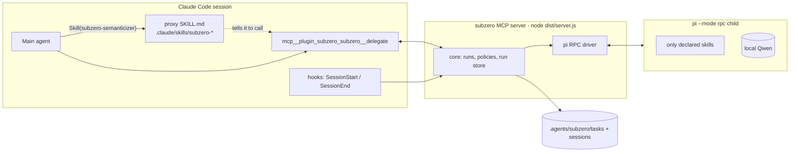

# First target: Claude Code parent → pi child

Status: analysis · 2026-10-30 · reads with [design.md](design.md) and [decisions.md](decisions.md).

> **Update 2026-11-12.** This page analyses one parent host (Claude Code) with one child host (pi). The vocabulary is
> now fixed: *parent host* and *child host*, and the bare "host" below means whichever the sentence is about. pi
> also becomes a parent host ([design.md](design.md) §5.5), and the Claude Code parent gains background tasks and
> a cancel command ([design.md](design.md) §5.4). The agent file now requires `medium`, `general` and `fallback`
> (decision 29 in [decisions.md](decisions.md)).

> **Update 2026-11-03.** Brought into line with the spike's Sigil contracts (`design/*.sigil`), which win
> where they differ: the result has no changed-file list, a task whose owner process died is `abandoned`
> (not `parent_gone`), concurrency is an optional parallel limit per model endpoint counted inside one
> process, and the stop reason `aborted` is a `cancelled` status with no failure kind.

Versions researched: **Claude Code 2.1.314** (latest, docs at code.claude.com) and **pi 1.4.0** (latest,
`@earendil-works/pi-coding-agent`, read from the published package). Versions on the dev machine:
**claude 2.1.285, pi 0.87.0**. Items marked 🧪 were tested on the dev machine. Items marked ⚠ are not
verified.

## 1. Verdict

**Feasible today with no blocking gaps.** Every piece subzero needs exists in documented form on both
sides:

| Need | Claude Code side | pi side |
|---|---|---|
| Give the parent a delegate tool | Plugin with a stdio MCP server | n/a |
| Route "I need skill X" into delegation | Proxy `SKILL.md` in `.claude/skills/` (hot-reloaded), `allowed-tools` pre-approves the call | n/a |
| Long tasks without blocking the parent | Auto-background after 120s; progress resets the 30-min idle timeout; MCP Tasks (2.1.304+) | n/a |
| Exactly the declared skills | n/a | `-ns --skill <dir>` 🧪 |
| Clean child context | n/a | `-nc -ne -np -na --no-mcp --no-themes` 🧪 |
| Model + reasoning per agent | n/a | `--model provider/id --thinking <level>`; local Qwen via `models.json` 🧪 |
| Drive and stream | MCP progress notifications | `pi --mode rpc` (JSONL commands and events) 🧪 |
| Keep, resume, attach | n/a | `--session-dir` + `--session-id`; reopen in the pi TUI with the same flags |

**Not covered by anyone else:**
- `pi-subagents` (installed on the dev machine, v0.70.1) does the mirror image: a **pi** parent with
  pi, Claude or Codex children. It has per-agent `skills:` and `skillPath:`. It cannot be driven from
  Claude Code.
- Claude Code's own `context: fork` skills give the context isolation, but only with Claude models in
  the same process.

So Claude parent + pi/Qwen child is an open niche.

## 2. Architecture for this pair



### 2.1 Plugin layout

```
subzero/                                  # Claude Code plugin
  .claude-plugin/plugin.json              # name: "subzero", userConfig, hooks, mcpServers
  .mcp.json                               # { "subzero": { "command": "node",
                                          #   "args": ["${CLAUDE_PLUGIN_ROOT}/dist/server.js"],
                                          #   "env": { "SUBZERO_DATA": "${CLAUDE_PLUGIN_DATA}" } } }
  dist/server.js                          # one bundled file, no runtime deps, no npx
  hooks/hooks.json                        # SessionStart (sync proxies, reloadSkills, record session id)
                                          # SessionEnd (flush run store)
  skills/subzero/SKILL.md                 # one static "how to delegate well" skill (user-invocable)
```

- Tool names: `mcp__plugin_subzero_subzero__<tool>`. The full name must stay under 128 characters.
- **The server's cwd is the plugin root, not the project.** Read the project from `CLAUDE_PROJECT_DIR`
  or MCP `roots/list`. Never use `process.cwd()`.
- Persistent plugin state goes in `${CLAUDE_PLUGIN_DATA}`, which survives updates. Project state (run
  records, child sessions) goes in `<project>/.agents/subzero/`.
- Install: `claude plugin install subzero@<marketplace> --scope project`, which writes `enabledPlugins`
  to `.claude/settings.json`. Teammates still install it themselves. Use `--plugin-dir` for development.

### 2.2 Tool surface and its context cost

Tool search is on by default, so only tool *names* and the server **`instructions`** (cap 4,096
characters, always in context) load at start. Full schemas load on demand through `ToolSearch`.

| Tool | Loading | Notes |
|---|---|---|
| `delegate(agent, brief, files?, expected_output?, from?, wait?)` | `_meta["anthropic/alwaysLoad"]: true` | The one tool used on every delegation. Load it upfront so the proxy-skill path doesn't need a ToolSearch hop. Keep its schema small. |
| `continue(task, message, overrides?)` | deferred | Same task, same pi session; respawns pi if its process has exited |
| `ask(task, question)` | deferred, `readOnlyHint` | Answers from a read-only probe fork; the main session is untouched |
| `tasks(task?, scope?, detail?)` | deferred, `readOnlyHint` | Lists this conversation's tasks, or returns one task's report (no LLM) |
| `await(tasks, timeout_s)` / `cancel(task)` | deferred (`await` is `readOnlyHint`) | Used by subagents, `-p` runs and explicit background mode |

`delegate` also covers fork and rerun through `from: {task, mode}`, so a new session always means a new
task id. The task model is in [design.md](design.md) §3.1, §3.5 and §3.6.

**Where the agent catalog lives.** Use the proxy skills (one listing entry per agent, sharing Claude's
1% skill budget), not the tool description. Server `instructions` carry only the delegation rules:
"write a self-contained brief; the child cannot see this conversation". When the YAML changes, the
server rewrites the proxies and sends `notifications/tools/list_changed`, honored since 2.1.0.

### 2.3 Proxy skills (the "parent needs the skill → use the subagent" path)

The generated file is `<project>/.claude/skills/subzero-semanticizer/SKILL.md`. That directory is
watched and **hot-reloaded**. If it didn't exist at session start, the SessionStart hook returns
`reloadSkills: true`.

```markdown
---
name: subzero-semanticizer
description: <copied from the agent's description in .agents/subzero.yaml>
allowed-tools: mcp__plugin_subzero_subzero__delegate
---
Do not do this task yourself. Call `mcp__plugin_subzero_subzero__delegate` with
agent "semanticizer" and a brief that stands on its own: the goal, relevant file paths, constraints,
and the output you expect. The sub-agent cannot see this conversation. $ARGUMENTS
```

- `allowed-tools` pre-approves the delegate call **for that turn only**. Full MCP names are allowed
  there, per the docs.
- About 80 tokens enter the parent instead of the skill body. Claude re-attaches invoked skills after
  compaction, so the saving repeats.
- **Claude Code does not read `.agents/skills`**: it isn't a documented skill root. So real skills in
  `.agents/subzero/skills/` (or even `.agents/skills/`) never leak into the Claude parent. That is
  safe for this pair. pi reads `.agents/skills/` only in trusted projects, and the child runs with
  `-na`.
- Optional hardening: a PreToolUse hook on `Skill` (input `{skill, args?}`, read from the binary ⚠)
  can deny a real skill that also exists in `~/.claude/skills` and point Claude to the proxy instead.
  A user typing `/skill` bypasses PreToolUse; that goes through `UserPromptExpansion`, which can only
  block or add context.

### 2.4 Long-running delegations

| Where the call comes from | What happens | subzero must |
|---|---|---|
| Main conversation, interactive | Blocks for up to 120s, then **auto-backgrounds** (2.1.212). Claude gets a task id, keeps working, and is notified when the result lands. | Send `notifications/progress` at least every 60s, which resets the 30-min stdio idle timeout. Nothing else: native background works. |
| A Claude subagent (Agent tool) | Never auto-backgrounds; blocks the subagent | Progress plus a wall-clock limit. Offer `wait: false` + `await`. |
| `claude -p` / SDK | Not backgrounded unless `CLAUDE_AUTO_BACKGROUND_TASKS=1`, and a backgrounded result is lost at exit | Wait in non-interactive or unknown mode. The current parent-process check also treats terminal-less IDE and SDK sessions conservatively as non-interactive. |
| MCP tasks | A task-augmented `tools/call` gets a handle; the client can poll `tasks/get`, collect with `tasks/result`, and cancel with `tasks/cancel`. | Built using SDK 1.32's experimental task protocol when a call carries `params.task`. Claude Code 2.1.322 did not select it in our probe; an `asyncRewake` hook supplies completion notices for ordinary background calls. See [spike-results.md](spike-results.md). |

Progress text should come from domain events, e.g. `semanticizer · turn 3 · read src/model.ts`, so the
user sees real activity in the collapsed tool view and in `/tasks`. It is one line (agent, kind of the
latest event, tool and target path, elapsed time; "waiting" while the run is `Pending`), at most one
notification a second, with a heartbeat after 30 s of silence. It never carries agent message text, tool
output, tool arguments other than a path, the stderr tail or skill content.

### 2.5 Results

- The model sees `content`. `structuredContent` is supported, but always fill `content` too.
- Result over 50k characters → Claude saves it to a file. Over 10k tokens → a warning. The cap is 25k.
  subzero never cuts a result: it tells the child to keep its reply under 48,000 characters, and an
  `await` reply that would pass 50k gives the later results as pointers to `tasks(<id>)` instead.
- Shape (there is no changed-file list; the user reviews the tree with git):

```
task: sz-7f3k2q · turn 2 · semanticizer · status: completed
summary: <the whole of pi get_last_assistant_text, never cut>
usage: { tokens, cost, model, duration }
next: continue(task) · ask(task, question) · tasks(task, detail: report)
```

The task id comes first, so it is still in Claude's history after compaction. If it gets lost anyway,
`tasks()` lists this conversation's tasks. The SessionStart hook records the Claude session id, so
"this conversation" survives `/clear`.

### 2.6 Cancellation and shutdown

- **Esc during a waited call:** the server receives `notifications/cancelled{requestId}` (the SDK
  passes the abort on ⚠, read from the binary).
  - Send RPC `clear_queue`, then `abort` (wait up to 5s), then close stdin, then SIGTERM, then SIGKILL
    the child's process group.
- **Esc on a backgrounded call** does not cancel it. Stopping it in `/tasks` does.
- **Session exit:** Claude sends the server SIGINT, then SIGTERM after 100ms, then SIGKILL 400ms later.
  That is too fast for a graceful abort.
  - Rely on the pipe: **don't detach the child**. When the server dies, pi's stdin hits EOF and pi
    shuts down cleanly (documented RPC behavior).
  - The session file stays, so the task can be continued later.
  - At start-up, and again before a collect, a cancel or a listing, find tasks whose latest index line
    says running and whose owner process (pid and start time, recorded on the task's first index line)
    is gone or has another start time, and mark them `abandoned`. The sweep signals no process. An
    abandoned task has no result and can still be listed, attached and shown. A result already stored
    in the record outranks a later `abandoned` line.

### 2.7 Permissions

- **A plugin cannot ship allow rules.** Approval comes from one of these:
  1. the proxy skill's `allowed-tools`, for one turn;
  2. a user or project rule `"permissions": {"allow": ["mcp__plugin_subzero_subzero__*"]}`, which
     `subzero init` can offer to add;
  3. the auto-mode classifier;
  4. a plugin PreToolUse hook returning `allow` (since 2.1.314, Cowork auto mode treats it as no
     answer).
- Under `-p`, any call that isn't approved is denied. Document this for CI use.
- pi has **no approval system**. `-a` only controls project trust. The child's permissions are
  therefore just its **tool allow-list**:
  - `read-only` → `--tools read,grep,find,ls`
  - `workspace-write` → `read,grep,find,ls,edit,write,bash`
  - subzero adds nothing stronger. A child with `bash` can write anywhere. Git is the record: subzero
    reports no changed files, and the user reviews or reverts with git (§6.1).
- **Asking the user from a child:** extension dialogs in RPC mode emit `extension_ui_request` and
  **block until answered**. With `-ne` the only possible source is subzero's own extension.
  - v1: auto-reply `cancelled` and return `needs_input`.
  - v2: relay the dialog to Claude as an MCP **elicitation** (form mode, supported since 2.1.287,
    interactive sessions only).

## 3. The pi child

### 3.1 Launch command (🧪 isolation flags checked on pi 0.87)

The current child launch flags were rechecked on pi 1.5.2. A real child started
through `PiDriver` with a local model completed an RPC request on that version.
The existing launch test pins the isolation flags and explicitly supplied skills.

```
pi --mode rpc --offline -na -ne -nc -np --no-themes [--no-mcp]
   -ns --skill <abs>/skill-a --skill <abs>/skill-b
   --model r9700/Qwen3.8 --thinking high
   --tools read,grep,find,ls[,edit,write,bash]
   --append-system-prompt <task>/instructions.md
   --session-dir <project>/.agents/subzero/sessions --session-id <task-id> --name "subzero:<agent>:<task-id>"
```

Launch options: cwd = project root, env `PI_OFFLINE=1 PI_TELEMETRY=0`, stdio piped, not detached.

| Flag | Why |
|---|---|
| `--mode rpc` | Commands (prompt, abort, steer, stats, last text) plus events, and the ability to answer dialogs |
| `--offline` | No catalog refresh, update check or **auto-install of missing pi packages** at start-up |
| `-na` | Ignore project `.pi/*` and project `.agents/skills` even when trust was saved |
| `-ne` | Drops user and package extensions, which could inject skills, tools, context or dialogs. In 1.4.0 it also drops the built-ins (MCP, codemode, tool_search, llama.cpp); add back with `-e builtin:<name>`. On 0.87 the built-in `llama` command remained 🧪. |
| `--no-mcp` | Since **1.0.4** only, so leave it out on older versions. `-ne` already removes built-in MCP. |
| `-nc`, `-np`, `--no-themes` | No AGENTS.md/CLAUDE.md, prompt templates or themes |
| `-ns --skill` | Exactly the declared skills 🧪. The model loads a skill with `read`, so keep `read` enabled. Skills that read siblings by relative path (`../sigil-understand/...`) must sit side by side in the overlay directory. |
| `--append-system-prompt <file>` | The agent's `instructions`. It also **replaces** the user's `APPEND_SYSTEM.md`. `-nc` does not cover `~/.pi/agent/SYSTEM.md`, so detect it and warn. |
| `--session-dir`/`--session-id` | Sessions are stored outside the user's own `~/.pi/agent/sessions`, with a predictable path for resume and attach |

The **brief** is sent as the RPC `prompt` message, not put in the system prompt. That way it appears in
the session as the user turn, and resume and attach show what was asked.

**Measured on the dev machine** (`get_commands` over RPC):

| Launch | What loaded |
|---|---|
| Default `pi --mode rpc` | 41 skills (from `~/.agents/skills` and pi packages), 6 prompt templates, about 20 `pi-subagents` commands |
| `-ns --skill test-skill -ne -nc` | `skill:test-skill`, 6 prompt templates (from packages), `llama` |
| Full flag set above | `skill:test-skill` + `llama` (pi built-in) |
| `--skill /missing --skill test-skill` | Only `test-skill`. **A missing path is ignored silently**: no error, no stderr. |
| `--model nonexistent/foo` | Exits 1 before any output: `Model "nonexistent/foo" not found` |

### 3.2 RPC driver protocol

1. Spawn, then send `get_state`. The reply means pi is ready; there is no ready event and no header in
   RPC mode. It returns `model`, `thinkingLevel` and `sessionId`.
2. `get_commands`, then check that the `source:"skill"` entries **exactly equal** the declared set.
   Otherwise fail with `SkillMismatch`. This check is required, because a missing path fails silently.
3. `prompt{message: brief}`, then check `data.disposition`:
   - `handled`: done.
   - `started`/`queued`: stream events until **`agent_settled`**. `agent_end` is *not* final, because
     retries, compaction or queued follow-ups may continue.
4. Turn events into progress:
   - `tool_execution_start/end`: ToolActivity.
   - `message_update` text deltas: buffer them; don't forward each token.
   - `auto_retry_*`: a "retrying" status.
5. Finish:
   - `get_last_assistant_text` gives the summary.
   - The last assistant `message_end.stopReason` gives the status: `stop` → completed,
     `length` → truncated, `error` → failed with the failure kind `error` and a short bounded message,
     `aborted` → cancelled (a status; no failure kind). A clean exit with no assistant message is
     failed with the failure kind `error`.
   - `get_session_stats` gives tokens, cost and context use.
6. Record the turn's entry range: first entry id from `get_entries since <previous leaf>`, plus the
   new `leafId`. This lets the task fork at that turn later.
7. `process: exit`: close stdin and wait for exit (the task becomes idle). `process: keep`: hold the
   process until `continue` or the TTL runs out.

Framing:
- Split stdout on LF only and strip a trailing CR. **Never use Node `readline`**, which also splits on
  U+2028/2029.
- Decode UTF-8 from a byte buffer, not chunk by chunk.
- stderr is for diagnostics only.

**Write our own client, about 150 lines.** pi's exported `RpcClient` defaults to a 60s wait, which is
too short for local models, and it doesn't handle `extension_ui_request`.

Why spawn the CLI rather than embed the pi SDK:
- It uses **the user's installed pi**, with its login, `models.json` schema and version.
- It can be killed by process group.
- A crash in the child can't take down the MCP server.
- The SDK would pin subzero to its own pi version and skips built-in extensions.

### 3.3 Models: your local Qwen

The dev machine already has `r9700/Qwen3.8` (27B, `openai-completions`, 130k context, 16k max output),
with `thinkingLevelMap` low…max and `supportsReasoningEffort: true`. So `--model r9700/Qwen3.8
--thinking high` sends `reasoning_effort: "high"`.

- ⚠ **Check that the server honors it.** vLLM, SGLang and llama.cpp usually control Qwen thinking
  through `chat_template_kwargs.enable_thinking` rather than `reasoning_effort`. If so, set
  `compat.thinkingFormat: "qwen-chat-template"` (on/off only). For graded levels, use `"chat-template"`
  with `thinkingTokenBudgetField` (`thinking_token_budget` for vLLM, `thinking_budget_tokens` for
  llama.cpp) and `thinkingBudgets`.
- Otherwise `reasoning: high` and `low` may silently behave the same.
- Validate when resolving the config: RPC `get_available_models` (JSON), or rely on the exit 1 at
  start-up for an unknown `--model`. `--list-models` exits 0 even when nothing matches.
- **One local GPU serves one request at a time.** Set `parallel: 1` on the model endpoint's entry in
  `endpoints:`; there is no default cap. Otherwise parallel delegations queue inside the server and hit
  the parent's timeouts. The limit counts only the children of one process: a terminal `subzero run` or a
  second Claude window is not counted.
- Under `--offline`, pi's model catalog is frozen. That's fine for `models.json` providers.

### 3.4 Task ↔ pi session mapping: continue, respawn, fork, ask, attach

**The pi session id *is* the task id** (`--session-id sz-7f3k2q`). The file is
`<project>/.agents/subzero/sessions/<ts>_sz-7f3k2q.jsonl`, created at the first prompt, and its path is
read back from `get_state.sessionFile` and stored in the task index. You can tell a task from its pi
session and the other way round without a lookup, and pi's own `/resume` shows it named
`subzero:<agent>:<task-id>`.

The session **remembers** model, thinking level and active tools. It **does not remember** skills,
context files or extensions; those come from the flags at each launch. So the task's **LaunchSpec**
holds the full command, and every operation below reuses it:

| Operation | pi mechanics |
|---|---|
| `continue` (respawn) | LaunchSpec + `--session <abs file>` (always a path: an id that matches another project prompts on stdin and would corrupt RPC ⚠). Then `prompt`. If the process is still live (`process: keep`), just send `prompt`, or `follow_up` while a turn is streaming. |
| Change model on continue | LaunchSpec with `--model`/`--thinking` swapped. The session records a `model_change` entry. |
| `fork` at turn *n* | `--fork <abs file> --session-id sz-<new>`, then RPC `fork {entryId: turns[n].entries.firstId}` (forks from that user message) |
| `rerun` | Fresh LaunchSpec, new `--session-id`; the brief is sent again |
| `ask` (probe) | `--fork <abs file> --session-id sz-<task>-q<n> --tools read,grep,find,ls`, then `prompt(question)`. The answer is bounded and the probe is kept under the task. |
| `tasks(report)` | No pi call: a projection of subzero's `events.jsonl`. pi `get_entries` can rebuild it if the log is lost. |
| `attach` | LaunchSpec without `--mode rpc` + `--session <abs file>`. Opens **the pi TUI on the child's session**. Turns typed there are recorded as `by: user` the next time subzero reads `get_entries since <leaf>`. |
| `show` | `pi --export <file> out.html` |

**No session file locking in pi.** Two pi processes on one file write interleaved branches. subzero
holds a per-task file lock: `continue`, `attach` and `ask` wait for or refuse a live run. `ask` and
`fork` read the file but write a *new* one, so they are safe to run alongside.

## 4. Context accounting: does it actually keep the parent clean?

| Cost in the parent | Without subzero | With subzero |
|---|---|---|
| Always present | Skill listing entry (~50–150 tokens per skill) | Proxy listing entry (same) + server instructions (~200 tokens) + `delegate` schema (~150 tokens) |
| When used | Full skill body (often 1–5k) + every file and tool output the work produces | Proxy body (~80) + brief written by Claude (~200–600) + result (the child's final answer, sized by the reply budget in its brief) |
| After compaction | Skill body re-attached (≤5k per skill, 25k total) | Proxy body only |

Break-even: subzero is worth it once **skill body + work output > roughly 1.5k tokens**. Below that,
the cost of writing a brief and of a cold child (process start, cold prompt cache, loading the skill)
outweighs the gain. Tell users to mark small skills `host: inline`, meaning not delegated (a new
option), instead of wrapping everything.

**Measure it:** the spike must compare `/context` in the parent before and after one delegation.
`/context` lists MCP instructions as their own row since 2.1.283.

## 5. Risks specific to this pair

| # | Risk | Mitigation |
|---|---|---|
| R1 | Version skew: dev machine has claude 2.1.285 / pi 0.87; MCP Tasks needs 2.1.304, `--no-mcp` needs pi 1.0.4, and pi 1.2.0 changed `before_agent_start` | Probe `pi --version` and `claude --version` at start; choose flags by capability; pin tested ranges in `subzero.lock`; keep contract tests on recorded RPC fixtures |
| R2 | A missing `--skill` path is silently ignored 🧪 | Check that each skill folder exists before launch, and check the `get_commands` set after |
| R3 | `extension_ui_request` blocks forever | Always answer: auto-cancel, or relay through elicitation |
| R4 | `CLAUDE_CODE_SESSION_ID` env goes stale after `/clear` | Take the session id from a SessionStart hook (it reruns after `/clear`) or from the `claudecode/toolUseId` `_meta` |
| R5 | The parent writes thin briefs; a weak model then guesses | Server instructions and proxy-body rules; `files`/`expected_output` fields in the schema; let the child return `needs_input` with questions |
| R6 | Small local models do worse at long tool loops | Narrow skills, tool allow-lists, a turn and wall-clock limit per agent, `length` reported as truncated |
| R7 | Parent and child edit the same files | Default `read-only`. A write-enabled agent should own a path scope. subzero records no changed files; the README warns the user to review the tree with git. |
| R8 | Skills written for Claude (`allowed-tools`, "use the Task tool") don't work in pi, which ignores `allowed-tools` | `subzero validate` flags host-specific references in skills bound to pi agents |
| R9 | `~/.pi/agent/SYSTEM.md` is not covered by `-nc` | Detect it and warn, or use a shadow `PI_CODING_AGENT_DIR` with only `auth.json`/`models.json` symlinked |
| R10 | Session transcripts may contain secrets | `.agents/subzero/` is gitignored; `prune` deletes old task records and their pi sessions |
| R11 | Unclear whether `grep`/`find` tools fetch `rg`/`fd` binaries over the network under `--offline` ⚠ | Check in the spike; fall back to `--tools read,ls,bash` |
| R12 | A skill bundle may not fit a local model's context. The interpreter child loads sigil-understand (whose language reference alone is ~57 KB) and sigil-egglog, plus the prepared request. Compaction mid-reading could drop the rules it is following. | Measure peak child context with `get_session_stats` in the spike. Record compactions as an event. If it does not fit, that is a finding about the bundle, not a subzero bug. |
| R13 | Routing: a skill asks for a "fresh sub-agent" and the host picks its own mechanism instead of `delegate` | Routing lines in the native subagent's prompt (§6.1). Inside a Claude subagent there is no Agent tool, so `delegate` is the only option (⚠ re-check). In the main conversation, a `PreToolUse` hook on the Agent tool is the fallback. |
| R14 | A child's real output is bigger than the reply budget (e.g. sigil-write's review report, once sigil-write is delegated to) | `result.report_file` (v0.2): the child writes the full output to a file in the task record; the result carries a summary and the path. Not needed in the spike: the interpreter's output is its answer file. |

## 6. Spike plan (about 1 week)

Goal: show that a real, heavy skill can run in a Claude Code subagent, hand its own sub-agent work to
pi + local Qwen, get back a **usable** result, and keep the main conversation clean. Run on the dev
machine (Claude 2.1.285 + pi 0.87 → upgrade to 1.4.0 + local Qwen).

### 6.1 The experiment: direct sigil-evaluate

The test workload is [sigil](../../sigil)'s `sigil-evaluate`, called **directly** on a design. The
sigil skills depend on each other like this (from each skill's `compatibility.json` and the
`../sibling/` paths it reads):

```
sigil-write          → sigil-understand, sigil-evaluate (starts it as a sub-agent), sigil-compute-design
sigil-evaluate       → sigil-understand, sigil-compute-design
sigil-compute-design → sigil-understand, sigil-egglog   (starts one interpreter child per source)
sigil-understand, sigil-egglog → nothing
```

Called directly, `sigil-evaluate` runs compute-design's review preparation itself: one fresh
**interpreter** child per unread source (Slotted has seven), plus at most two re-asks, then
`sigilc check`, then the judgment-heavy review. That makes it the sigil skill with the most
sub-agents, and the one the spike targets. It is also:

- **Heavy.** sigil-evaluate, sigil-understand and sigil-compute-design together carry well over 100 KB
  of references, far above break-even (§4).
- **Leaves delegation to the host.** compute-design says "delegate the reading to one fresh child";
  the host decides how. That is the call subzero serves.
- **Writes.** Preparation directories and a private claims store in a run directory, a write-back
  into `.sigil/claims/`, one answer file per interpreter. It runs `sigil`/`sigilc` through bash.
- **Already measurable, twice over** (see §6.2).

`sigil-write` is not in the spike. It also runs the review preparation itself and then hands the
evaluator a frozen bundle, so it would add a second layer of sub-agents without testing anything new.

**Shape: the evaluator is a native Claude subagent; its interpreters are delegated to pi.**

```
Claude Code main conversation         sees only the Agent call and the evaluator's final report
  └─ Agent → sigil-evaluator          Claude Code subagent (.claude/agents/sigil-evaluator.md):
       │                              review preparation, sigilc, the review itself
       └─ delegate → sigil-interpreter    pi + Qwen, one fresh task per source / re-ask
```

- **The main conversation stays clean.** The skill bodies, references, `sigilc` output and readings
  live in the evaluator subagent's context and die with it.
- **Claude keeps the judgment.** The review stays on a Claude model. Qwen gets the narrow, repeated
  job: read one prepared source and write claim rows.
- **subzero fills a gap Claude Code has.** Claude Code subagents cannot start subagents of their own
  (⚠ re-check on 2.1.285). So in plain Claude Code, sigil-evaluate inside a subagent cannot start its
  interpreters and can only review from the sources ("computed coverage unavailable"). subzero's MCP
  `delegate` tool is available inside the subagent, so the computed path works.
- **subzero manages depth 1 only.** The evaluator subagent is Claude's, not subzero's.

```yaml
agents:
  sigil-evaluator:
    description: Reviews a Sigil 0.9 design for meaning, consistency, ownership and simplification.
    host: native                          # a subagent of the parent host itself, not spawned by subzero
    skills: [sigil-evaluate, sigil-understand, sigil-compute-design, sigil-egglog]
    delegates: [sigil-interpreter]
  sigil-interpreter:
    description: Reads one prepared Sigil source and writes its claim rows to the named answer file.
    host: pi
    model: r9700/Qwen3.8
    skills: [sigil-understand, sigil-egglog]
    tools: [read, grep, find, ls, write]
    expose: { proxy_skill: false }        # only reached through the evaluator
```

For the spike, `.claude/agents/sigil-evaluator.md` is written by hand:

```markdown
---
name: sigil-evaluator
description: Reviews a Sigil 0.9 design for meaning, consistency, ownership and simplification.
skills: [sigil-evaluate, sigil-understand, sigil-compute-design, sigil-egglog]
# tools omitted: inherits Read/Write/Bash and the subzero MCP tools
---
When a skill asks you for a fresh child to interpret a prepared sigilc request, call
`mcp__plugin_subzero_subzero__delegate` with agent `sigil-interpreter`. The brief must stand on its
own: the request and guidance file paths, the exact answer file path to write, and the round.
```

Later, subzero generates this file from `host: native` (D12, compile to native).

Things this shape brings, all handled in the spike:

- **Routing.** The routing line goes in the subagent's own prompt (above). With no Agent tool inside a
  subagent, `delegate` is the only way to start a child there, so no `PreToolUse` redirect is needed.
- **Keep the skills out of the main conversation (P19).** The sigil skills must be installed where the
  subagent's `skills:` can preload them but the main agent doesn't load them directly. Mark them
  `disable-model-invocation: true` or turn them off with `skillOverrides` in the main conversation.
  ⚠ Check that a subagent can still preload a skill hidden that way.
- **Long blocking calls.** A `delegate` call from a Claude subagent never auto-backgrounds; it blocks
  the subagent (§2.4). That is fine: the evaluator must wait for each reading anyway. subzero sends
  progress every ≤60s so the idle timeout doesn't fire, and the main conversation can run the
  evaluator subagent in the background.
- **Serial readings.** One local GPU serves one request at a time, so with `parallel: 1` on the endpoint
  (§3.3) the seven interpreter tasks run one after another: the rest stay `Pending` ("waiting" in the
  progress line). The evaluator can call `delegate` with `wait: false` for all of them and `await` them
  together. The limit counts only this server process's children.
- **Result size.** The interpreter's real output is the answer file its brief names, which
  `sigilc ingest` reads directly. Its `delegate` result only needs to say it finished.

pi has no approval prompts or sandbox, and subzero adds none. The `tools` list is the only limit.
subzero takes no snapshots and makes no copies of workspace files: **git is the record.** subzero
reports no changed files, and the user reviews or reverts with git; the README warns about it,
including when a parent and a child, or two children, write the same files.

### 6.2 Measures

sigil already has both measures; the spike runs them as they are.

- **Reading quality (the Qwen part):** the [Slotted interpretation benchmark](../../sigil/scripts/slotted-benchmark/README.md).
  It runs compute-design's whole-design action on `fixtures/slotted-planted`, a copy of Slotted with
  four planted problems, then runs the pinned `sigilc check` itself and scores the planted problems
  from that report against its answer key. Also recorded: final ingest state, re-asks used, units
  left unread.
- **Review quality (the whole loop):** sigil-evaluate's
  [claims review fixture](../../sigil/skills/sigil-evaluate/evals/claims-review-fixture.md) on the same
  planted Slotted design: which planted problems the final report names, plus tokens, turns, elapsed
  time, and the reader children's usage counted separately.

Two setups, same design revision, same Claude model and effort for the evaluator:

- **A (all Claude):** sigil-evaluate in the main conversation; its interpreters are Claude subagents.
  This is the only way plain Claude Code gets the computed path.
- **B (subzero):** main conversation → `sigil-evaluator` subagent → interpreters on pi + Qwen.

Also record: main-conversation `/context` before and after, interpreter context use at settle (pi reports
the value at the end of the run, not its peak), and the Qwen thinking levels (does `high` differ from
`low`? A separate B-low arm answers it, with its own agent definition at thinking `low`).

### 6.3 Plan

1. **Day 1. pi RPC driver as a CLI** (`subzero run sigil-interpreter "brief"` on one prepared Slotted
   source): launch, `get_state`, skill check, prompt, stream, `agent_settled`, result, session file.
   Skill overlay keeps siblings side by side. Feed the answer file to `sigilc ingest` by hand.
   Fixtures: record the JSONL.
2. **Days 2–3. Task store and MCP server:** `index.jsonl` and `task.json` with the LaunchSpec;
   `subzero attach` (the pi TUI opens on the child session) and `subzero show`, for debugging Qwen runs.
   MCP tools `delegate`/`tasks`/`await`/`cancel` plus progress, loaded with `--plugin-dir`. Test Esc
   cancel and session exit; an optional parallel limit per endpoint (`parallel: 1`).
3. **Day 4. The evaluator subagent.** Install the sigil skills, hidden from the main agent; write
   `.claude/agents/sigil-evaluator.md`; run it once on Slotted and check that every reading goes
   through `delegate` and the main conversation never loads a sigil skill.
4. **Day 5. Measure** A and B as in §6.2.

### 6.4 Exit criteria

Plumbing:
- The declared skills are exactly the loaded skills in every interpreter child.
- Every interpreter call goes through `delegate` (routing works).
- In B, the main conversation grows only by the Agent call and the evaluator's final report; no sigil
  skill or reference is loaded there.
- No orphaned pi processes after Esc or session exit.
- A task can be attached in the pi TUI after the parent session ends.

Usefulness:
- B's readings reach a completed ingest within sigil's own limit of two re-asks.
- B's report states computed coverage (not "unavailable").
- B's planted-problem scores and review findings sit in one table beside A's. The benchmarks set no
  threshold; whether B is good enough is decided from that table, and the decision is written down.

**Not in the spike** (moved to v0.2): `continue`, `ask` (probe fork), `fork`, `rerun` and `report`;
nested delegation inside subzero (a pi child that delegates, D14); `result.report_file`; generating
`.claude/agents/*.md` from `host: native`; and sigil-write. Each interpreter call is one fresh turn, so
none of these are needed to answer the spike's question.

## 7. Changes this analysis makes to the general design

- **Proxy skills go in a folder that depends on the parent host.** For Claude that is
  `.claude/skills/subzero-<agent>/`; Claude does not read `.agents/skills`. The earlier design said
  `.agents/skills`, which is right only for Codex and pi parents.
- **New agent option `host: inline`**: no delegation; the real skill is installed for the parent. Use
  it for small skills below break-even.
- **New agent option `host: native`**: the agent runs as the parent host's own subagent (a Claude Code
  `.claude/agents/*.md`), with its `delegates:` reachable through subzero. Use it when the main work
  needs the parent's model but its sub-agents can run elsewhere, as with sigil-evaluate. Hand-written in
  the spike; generated later (D12).
- **subzero also serves the sub-agents of a skill.** Many skills say "start a fresh sub-agent" and
  leave the mechanism to the host. subzero routes those calls to configured agents (R13). This is a
  third trigger next to `delegate` and the proxy skill. It also gives Claude Code subagents, which
  can't start subagents themselves, a way to delegate.
- **`result.report_file`** for agents whose full output the caller needs (R14, v0.2).
- **A child's permissions are a tool allow-list for pi.** pi has no approval prompts, so
  `needs_input` (kind `permission`) only happens through subzero's own pi extension.
- **The brief is the first user message, not part of the system prompt.** This keeps resume and
  attach meaningful.
- **No detached children.** Children die with the server through stdin EOF, and their sessions are
  kept for resume.
- **Nested delegation can wait.** Running the evaluator as a native Claude subagent keeps every subzero child at depth 1. When a
  delegated child does need to delegate (v0.2), it gets subzero's pi extension (the only exception to
  `-ne`) via `delegates:`, nested children share the parent's parallel limit, and a waiting run
  lends its place under that limit to its child so depth 2 can't deadlock on one GPU (D14).
